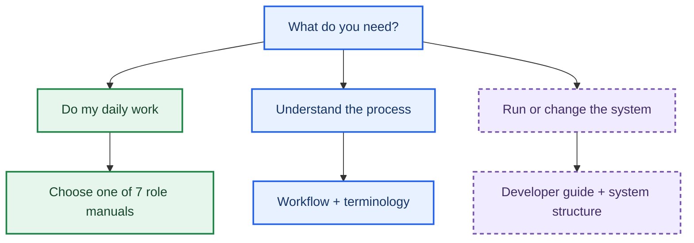
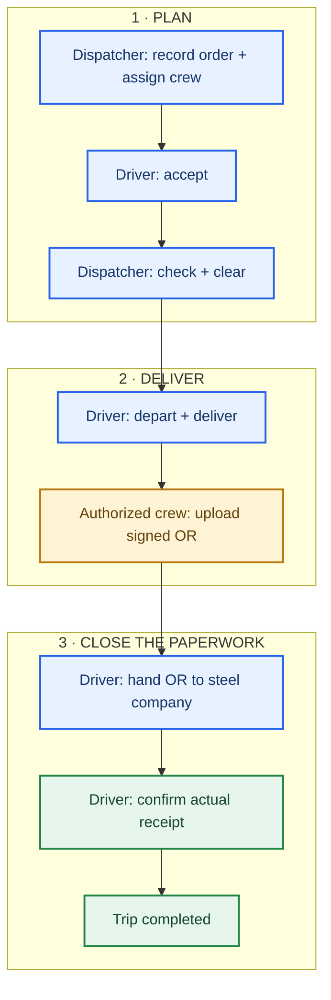

# Your guide to BM Enterprises

**Start with your job. Open the detailed rules only when you need them.**

**Preparing a release?** Start with the [QA checklist and deployment gate](runbooks/qa.md), then review [security hardening](decisions/security-hardening.md).

**First time using the system?** Follow [one delivery, step by step](runbooks/delivery-walkthrough.md), with the exact role, menu, button and expected result at each handoff.

| I want to…                                 | Open this                                                       |
| ------------------------------------------ | --------------------------------------------------------------- |
| Learn my daily tasks                       | [Pick my role](runbooks/roles/README.md)                        |
| Find a button or complete a task           | [Feature guide](runbooks/user-guide.md)                         |
| Understand a delivery from start to finish | [Service workflow](runbooks/service-workflow.md)                |
| Understand pay, expenses or billing        | [Financial policies — planned](decisions/financial-policies.md) |
| Run or maintain the app                    | [Developer guide](runbooks/development.md)                      |

**Choose daily work, process explanation or developer setup to find the right guide.**

## The whole delivery in one picture

**Plan with Dispatcher, deliver with the crew, then Driver confirms actual company receipt.**

> **Remember:** uploading the signed OR lets you reserve the next trip. It does **not** allow the next departure.

## What can I use today?

| LIVE — saves real operational records                                                     | PREVIEW — sample screens only                             | PLANNED                       |
| ----------------------------------------------------------------------------------------- | --------------------------------------------------------- | ----------------------------- |
| People, clients, orders, fleet, dispatch, My trips, ORs, dashboard, audit and permissions | Expenses, payroll, advances, billing and expanded reports | Driver PWA/offline capability |

Live code is not a production certification. Live Supabase, mobile and restore checks remain outstanding.

<strong>Complete module and role inventory</strong>

**Live** means a persistent API and working screen exist, not that production rollout or every external integration is certified. **Preview** means sample-only UI without financial persistence. **Planned** means required behavior is documented but absent from the application.

| Module            | Features                                                                           | Primary roles                                     | State                            |
| ----------------- | ---------------------------------------------------------------------------------- | ------------------------------------------------- | -------------------------------- |
| Account/access    | Clerk sign-in; employee link; active status; combined roles; backend authorization | All; Owner administers                            | Live                             |
| People            | Create/edit; activate/deactivate; roles; Clerk link                                | Owner, HR; limited Fleet/Dispatcher view          | Live                             |
| Clients           | Client/contact details                                                             | Dispatcher; Owner/Accounting view                 | Live; rates not stored           |
| Delivery orders   | Manual request, locations, date, tons, edit/cancel                                 | Dispatcher; Owner/Accounting view                 | Live                             |
| Fleet             | Capacity, truck records, maintenance                                               | Fleet, Owner; Dispatcher view                     | Live                             |
| Licenses          | Number/expiry updates; limited validity view                                       | Fleet/Owner write; HR read; Dispatcher limited    | Live                             |
| Dispatch          | Assign/reserve/clear; crew changes; truck replacement; cancel/fail                 | Dispatcher, Owner                                 | Live                             |
| My trips          | Assigned-only view; acceptance, departure, delivery                                | Driver; Helper view                               | Live                             |
| OR management     | Private signed OR/stamped images; signed links; receipt; correction                | Driver; enabled Helper; Owner correction          | Live; live-storage check pending |
| Dashboard         | Operational trip/resource summaries                                                | Owner, Dispatcher                                 | Live; not a financial report     |
| Audit/permissions | Mutation history; stored role matrix                                               | Owner                                             | Live                             |
| Trip expenses     | Entry, review, approval, explicit zero                                             | Dispatcher/Driver enter; Owner/Accounting approve | Preview; policies defined        |
| Earnings/payroll  | Percentages, deductions, statements, payments                                      | Owner, HR; crew own view                          | Preview; policies defined        |
| Advances          | Request, approval, release, repayments, balance                                    | Crew, HR, Owner                                   | Preview; policies defined        |
| Billing           | Eligible trips, carry-over, batches, invoices, payments                            | Accounting; Owner view/void approval              | Preview; policies defined        |
| Reports           | Financial and document exceptions                                                  | Each role within its remit                        | Expanded reports are previews    |
| Driver PWA        | Installation/offline capability                                                    | Crew                                              | Planned; browser only today      |

## Reading the handbook

- **Blue:** an action. **Green:** completion or a successful result. **Amber:** wait/check. **Purple dashed:** planned functionality. Labels carry the meaning even without color.
- Diagrams are fenced Mermaid blocks inside each Markdown page. Read them in a Mermaid-capable Markdown preview; edit them directly in the page.
- Expand **Full procedure** or **Reference** for exceptions and technical details.
- [Terminology](taxonomy.md) explains the words; [folder architecture](architecture.md#repository-folder-architecture) maps the directories and explains the code; [verification](runbooks/verification.md) explains what was checked.

<strong>Document authority and maintenance</strong>

The consolidated specification supersedes the archived proposal. Financial policies created at the user's request fill D4–D10 as **working implementation policies**, distinguish new choices from supplied requirements, and do not claim legal or production approval. Other unresolved decisions remain visible in the developer guide.

Change the API contract/tests, workflow, feature procedure and affected role manuals together. Label every feature live, preview or planned. Do not present an intended feature as available before persistence and authorization exist. Examples use fictional records; this handbook contains no credentials or personal employee data.

Reviewed against the consolidated specification dated **9 November 2026**. Documentation review: **18 November 2026**.
