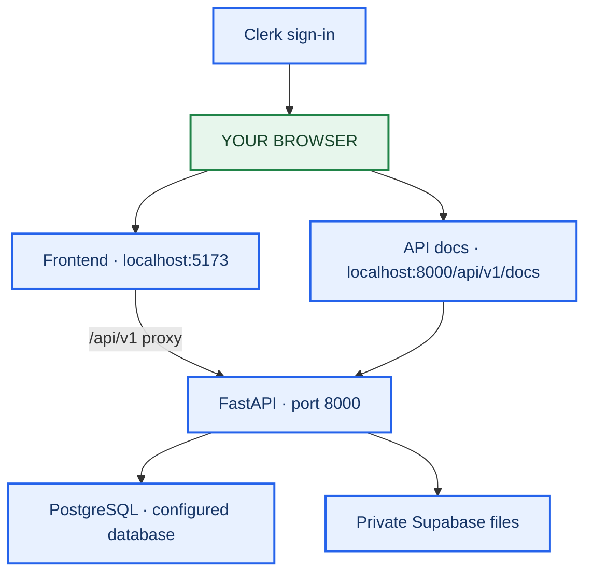
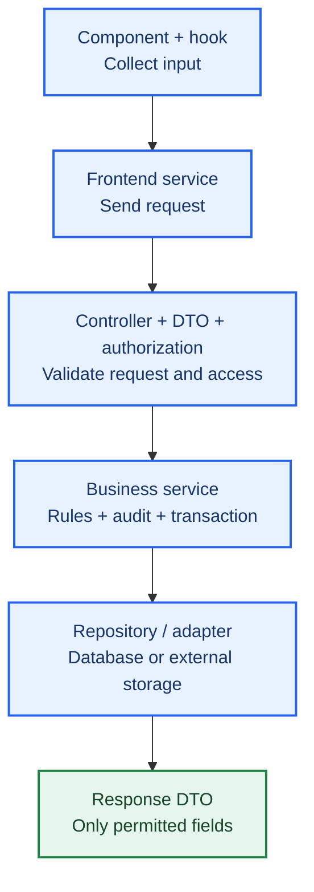

# System structure and code conventions

[Index](README.md) · [Developer setup](runbooks/development.md) · [Business workflow](runbooks/service-workflow.md)

> **Follow a request:** browser → API validation → business service → repository/adapter. Each layer has one job.

## Repository folder architecture

This is the current application layout. Start here when deciding where a file belongs.

```text
BM_Enterprises_Integration/
├── README.md                Project entry point and setup links
├── docs/
│   ├── README.md            Handbook navigation
│   ├── architecture.md     This folder map and layer responsibilities
│   ├── taxonomy.md         Business vocabulary, states and access levels
│   ├── decisions/          Financial working policies and decision index
│   ├── runbooks/           Setup, daily workflow, feature guides and checks
│   │   └── roles/          Seven role manuals and role index
│   └── archive/            Superseded proposal; historical reference only
├── tools/
│   ├── README.md           Maintenance and launch commands
│   └── scripts/            Backend module launcher and documentation checker
├── src/
│   ├── backend/            FastAPI, Python dependencies, migrations and tests
│   └── frontend/           React/Vite, npm dependencies and frontend tests
├── .github/                CI, PR template and development conventions
├── compose.yml              Coordinates frontend, API, database and pgAdmin
├── .env.example             Shared configuration template; no real credentials
├── .env                     Local configuration; ignored by Git
├── .editorconfig            Repository-wide editor defaults
├── .prettierrc.json          Shared formatting defaults
├── .prettierignore           Formatting exclusions
└── .gitignore               Git exclusions
```

Local-only folders such as `.venv/`, `node_modules/`, `dist/`, caches and `.git/` are not application source. Dependencies and build output belong inside the relevant application directory. The existing root `.venv/` contains workstation tools, local database files and private development-account records; it is ignored and must not be published.

### Backend: business rules and persistence

```text
src/backend/
├── main.py                  FastAPI entry point and application composition
├── src/
│   ├── Controller/          HTTP routes and DTO mapping
│   ├── DTO/                 Request validation and public response shapes
│   ├── Service/             Workflow, authorization, transactions and audit
│   ├── Entity/              Domain values, statuses and pure rules
│   ├── Contract/            Interfaces for repositories and external systems
│   ├── Repository/          SQLAlchemy queries, ORM models and unit of work
│   ├── Infrastructure/
│   │   ├── Clerk/           Identity directory and token/webhook verification
│   │   ├── Supabase/        Private object storage adapter
│   │   └── Imaging/         Image validation and sanitization
│   ├── Data/                Permission seed data
│   ├── config.py            Environment settings
│   ├── database.py          Engine and session creation
│   ├── providers.py         Dependency wiring and capability gates
│   ├── problem_details.py   Shared API error format
│   ├── rate_limiter.py      Shared request-rate control
│   └── request_limits.py    Request body limits
├── migrations/versions/     Versioned database changes
├── scripts/                 Owner bootstrap, reconciliation and API export
├── tests/                   Backend unit, integration and contract tests
├── openapi.snapshot.json    API contract baseline
├── pyproject.toml           Python lint, format and test configuration
├── requirements*.txt        Runtime and development dependencies
├── alembic.ini              Migration configuration
├── Dockerfile               Backend container build
└── .dockerignore            Backend build exclusions
```

### Frontend: feature UI and shared building blocks

```text
src/frontend/
├── src/
│   ├── main.jsx             Browser entry point
│   ├── App.jsx              Session gate and workspace composition
│   ├── index.css            Global theme and Tailwind entry
│   ├── pages/AppPages.jsx   Joins hooks to feature screens
│   ├── components/          Feature-specific presentation
│   │   ├── account/         Current employee profile
│   │   ├── administration/  People, permissions and audit screens
│   │   ├── clients/         Client records
│   │   ├── dashboard/       Operational overview
│   │   ├── dispatch/        Dispatch board and trip cards
│   │   ├── fleet/           Trucks and maintenance
│   │   ├── orders/          Delivery orders
│   │   ├── trips/           Crew progress, OR upload and receipt forms
│   │   ├── finance/         Financial preview screens
│   │   └── reports/         Reports preview
│   ├── hooks/               Loading, action orchestration and UI lifecycle
│   ├── services/            Feature API clients
│   ├── store/               Zustand state by feature
│   └── shared/
│       ├── components/      Shell, sign-in layout and reusable UI controls
│       ├── services/        HTTP, Clerk and asynchronous loading wrappers
│       ├── utils/           Pure formatting, navigation and form helpers
│       └── mockups/         Fictional data for explicitly labeled previews
├── tests/
│   ├── unit/                Pure-helper regression tests
│   └── components/          Role-specific screen rendering tests
├── design-preview/          Isolated sample-data preview harness
├── index.html               Main Vite HTML entry
├── preview.html             Sample preview HTML entry
├── package.json             Frontend scripts and dependencies
├── package-lock.json        Frontend dependency lock
├── vite.config.js           Vite plugins, allowed hosts and API proxy
├── eslint.config.js         JavaScript lint rules
├── Dockerfile               Frontend container build
└── README.md                Frontend commands and architecture links
```

### Where should a new file go?

| File or change                       | Put it here                                       | Example                               |
| ------------------------------------ | ------------------------------------------------- | ------------------------------------- |
| Feature-specific UI                  | `src/frontend/src/components/<feature>/`          | `trips/OrUploadForm.jsx`              |
| Reusable UI                          | `src/frontend/src/shared/components/`             | `ModalDialog.jsx`                     |
| Page composition                     | `src/frontend/src/pages/`                         | `AppPages.jsx`                        |
| Feature loading/actions              | `src/frontend/src/hooks/`                         | `useMyTrips.js`                       |
| Feature HTTP calls                   | `src/frontend/src/services/`                      | `tripService.js`                      |
| Shared SDK/transport                 | `src/frontend/src/shared/services/`               | `clerkSessionService.jsx`             |
| Pure shared calculation/formatting   | `src/frontend/src/shared/utils/`                  | `formatting.js`                       |
| Frontend regression test             | `src/frontend/tests/unit/` or `tests/components/` | `workflowRendering.test.jsx`          |
| Business workflow or permission rule | `src/backend/src/Service/`                        | `trip_service.py`                     |
| Database query/model                 | `src/backend/src/Repository/`                     | `trip_repository.py`                  |
| External provider adapter            | `src/backend/src/Infrastructure/<provider>/`      | `Supabase/supabase_object_storage.py` |
| Schema change                        | `src/backend/migrations/versions/`                | New versioned migration               |
| Operator command                     | `src/backend/scripts/`                            | `bootstrap_owner.py`                  |
| User/developer instructions          | `docs/` or `docs/runbooks/roles/`                 | This architecture page                |

Root files are limited to project-wide coordination, configuration and the entry README. Each app keeps its own dependency manifests, Dockerfile, test tooling and source. App-level files such as `src/backend/main.py`, `src/frontend/index.html`, `vite.config.js` and `src/main.jsx` stay at their expected entry locations so existing commands and containers keep working.

## Runtime structure

**Local frontend and API with database, storage and identity connections.**



<details>
<summary><strong>Directories, conventions and implementation notes</strong></summary>

The browser gets a Clerk session token; FastAPI verifies it and requires an active linked local employee. Role/capability data lives in PostgreSQL, not Clerk public metadata. The local development database is PostgreSQL; Supabase is used for private files. Hosting the database on Supabase remains compatible with the database configuration; the browser must not query application tables directly.

For temporary public sharing, ngrok can forward to Vite port 5173. Vite serves the app and proxies `/api/v1` to FastAPI port 8000. The frontend uses an empty API base URL for same-origin calls. Direct local API docs are `/api/v1/docs`. This is a development arrangement, not a production hosting design. pgAdmin is an operator tool, not part of user request processing.

</details>

## Backend ownership

**Request processing through the frontend and backend layers.**



<details>
<summary><strong>Directories, conventions and implementation notes</strong></summary>

| Location                          | Responsibility                                                | Keep out                                       |
| --------------------------------- | ------------------------------------------------------------- | ---------------------------------------------- |
| `src/backend/main.py`             | App/router/middleware configuration                           | Business workflow branches                     |
| `src/Controller/`                 | HTTP input, dependency checks, DTO output                     | SQL, storage SDKs, financial calculations      |
| `src/DTO/`                        | Typed validation and explicit public projections              | Persistence/side effects                       |
| `src/Service/`                    | Ownership/state rules, orchestration, audit, commit boundary  | Direct SQL or vendor SDK operations            |
| `src/Entity/`                     | Domain data/statuses/pure rules                               | FastAPI, SQLAlchemy, vendor SDKs               |
| `src/Contract/`                   | Repository/adapter interfaces                                 | Concrete infrastructure                        |
| `src/Repository/`                 | Queries, ORM/domain mapping, flush                            | Business approvals or independent commits      |
| `src/Infrastructure/`             | Clerk, Supabase, image sanitization adapters                  | Route-specific business authorization          |
| `src/Data/permission_matrix.json` | Seeded role grants and conditional flag names                 | User account credentials                       |
| `src/providers.py`                | Per-request dependency wiring and shared capability gate      | Feature-specific workflow logic                |
| `migrations/`                     | Versioned schema, seeds, constraints and lockdown             | Editing already applied migration history      |
| `tests/`                          | Contract, ownership, lifecycle, retries and database controls | Real personal data or live account credentials |

A trip references one order/truck and retained crew entries. OR documents and receipt fields belong to trips. Replacement records preserve original/replacement identities. Order and truck state is derived after changes. Audit records are append-only. Prospective financial records need separate models; do not overload operational statuses or add money calculations to controllers.

</details>

## Frontend ownership

**Component** displays · **Hook** coordinates · **Store** holds state · **Service** calls APIs · **Utility** stays pure.

<details>
<summary><strong>Directories, conventions and implementation notes</strong></summary>

| Location                                | Responsibility                                                          |
| --------------------------------------- | ----------------------------------------------------------------------- |
| `src/App.jsx`, `src/pages/AppPages.jsx` | Root and page containers joining hooks to screens                       |
| `src/components/<feature>/`             | Feature presentation, form input and callbacks; no direct API/SDK calls |
| `src/shared/components/`                | Shared UI, application shell and sign-in layout                         |
| `tests/unit/`, `tests/components/`      | Frontend checks, kept outside production source                         |
| `src/hooks/`                            | Loading/action orchestration and lifecycle                              |
| `src/store/`                            | Domain Zustand state; no business approval decisions                    |
| `src/services/`                         | Feature API clients                                                     |
| `src/shared/services/`                  | HTTP/Clerk wrappers and asynchronous collection loading                 |
| `src/shared/utils/`                     | Pure formatting, navigation, forms and action-visibility helpers        |
| `src/shared/mockups/`                   | Invented data for explicitly labeled previews                           |
| `design-preview/`                       | Isolated UI preview harness; not production business data               |

This change moves `collectionLoader` from `shared/utils/` to `shared/services/` because it performs asynchronous loading and store writes. Pure action selectors combine backend capabilities, assignment and trip status; they only control presentation. FastAPI still authorizes each operation. Limited employee records must render without guessing missing private fields. Missing Helper upload grants hide the upload controls.

Keep feature screens in their named component folder and reusable UI in `shared/components/`. Hooks, stores and API clients retain the established layer directories and descriptive feature names. Update imports and tests when moving a module; do not leave duplicate compatibility copies at old paths.

</details>

## Formatting and language rules

<details>
<summary><strong>Directories, conventions and implementation notes</strong></summary>

| Language/files | Standard/tool                                                                                               |
| -------------- | ----------------------------------------------------------------------------------------------------------- |
| Python         | Python 3.12 contract baseline, explicit type hints, 4 spaces, Black 110 columns, Ruff import/lint checks    |
| JavaScript/JSX | JavaScript + JSDoc, named descriptive exports, 2 spaces, single quotes, no semicolons, Prettier 100 columns |
| CSS/HTML       | Prettier; theme tokens in `src/index.css`, reusable UI primitives                                           |
| JSON           | Prettier/double-quoted keys; generated lockfiles and OpenAPI snapshots kept generator-owned                 |
| Markdown/YAML  | Prettier; relative documentation links and fenced commands                                                  |
| Shell/config   | EditorConfig UTF-8, final newline, spaces; Windows command/PowerShell files use CRLF                        |

`.editorconfig` and `.prettierrc.json` define these defaults. Frontend `npm run format` formats its sources/configs, documentation, main README, Compose and CI workflow. `npm run format:check` verifies the same scope in CI. Generated files, dependencies, build output, secrets and virtual environments are excluded. Python keeps its existing Black/Ruff configuration.

Use exported-function JSDoc and Python signatures; explicit response DTOs; descriptive business names; AI change markers per repository governance. Keep comments about invariants/decisions rather than narrating trivial expressions. The `.github` governance files remain the detailed layer reference; existing business code patterns in the developer guide govern incremental changes.

</details>

## Extension and review

**Read rules, implement in the correct layer, test, document and review.**


<details>
<summary><strong>Directories, conventions and implementation notes</strong></summary>

For finance: first add typed domain values and fixed-precision persistence, then contracts/repositories, transactional services, explicit DTOs/controllers, permission checks, migrations and regression tests; finally service/hook/store/screen integration. Implement [financial policies](decisions/financial-policies.md) as versioned configuration/ledger rules, not UI-only branches.

Test changed rules before broad formatting and preserve an API snapshot baseline. No API response shape changed in this workflow correction, so the snapshot should remain unchanged. PostgreSQL checks must use a dedicated test database because the suite recreates its public schema.

Prettier is pinned as a development dependency following its [official installation guidance](https://prettier.io/docs/install.html); it is not bundled as a runtime application feature. Record runtime and development dependency audit results separately. Do not force an unrelated major downgrade to silence an audit finding.

</details>
