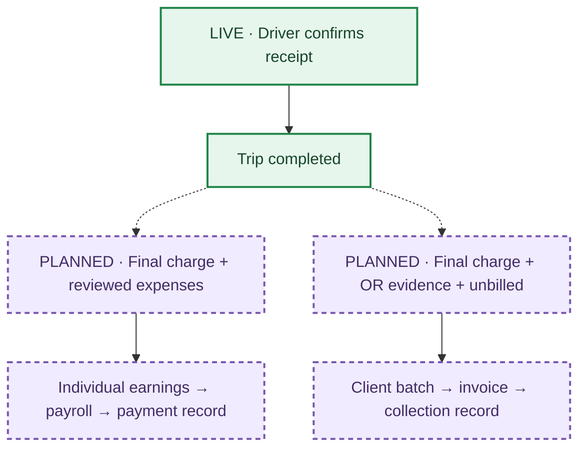
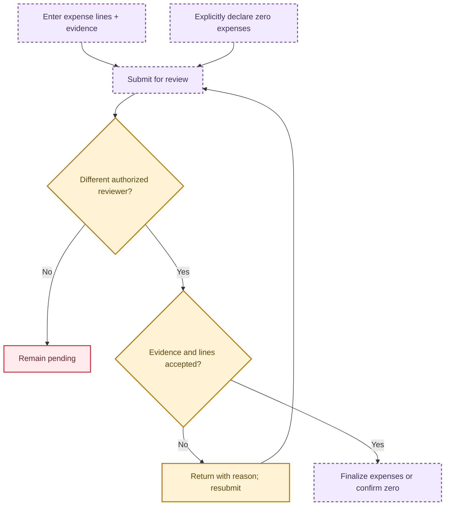
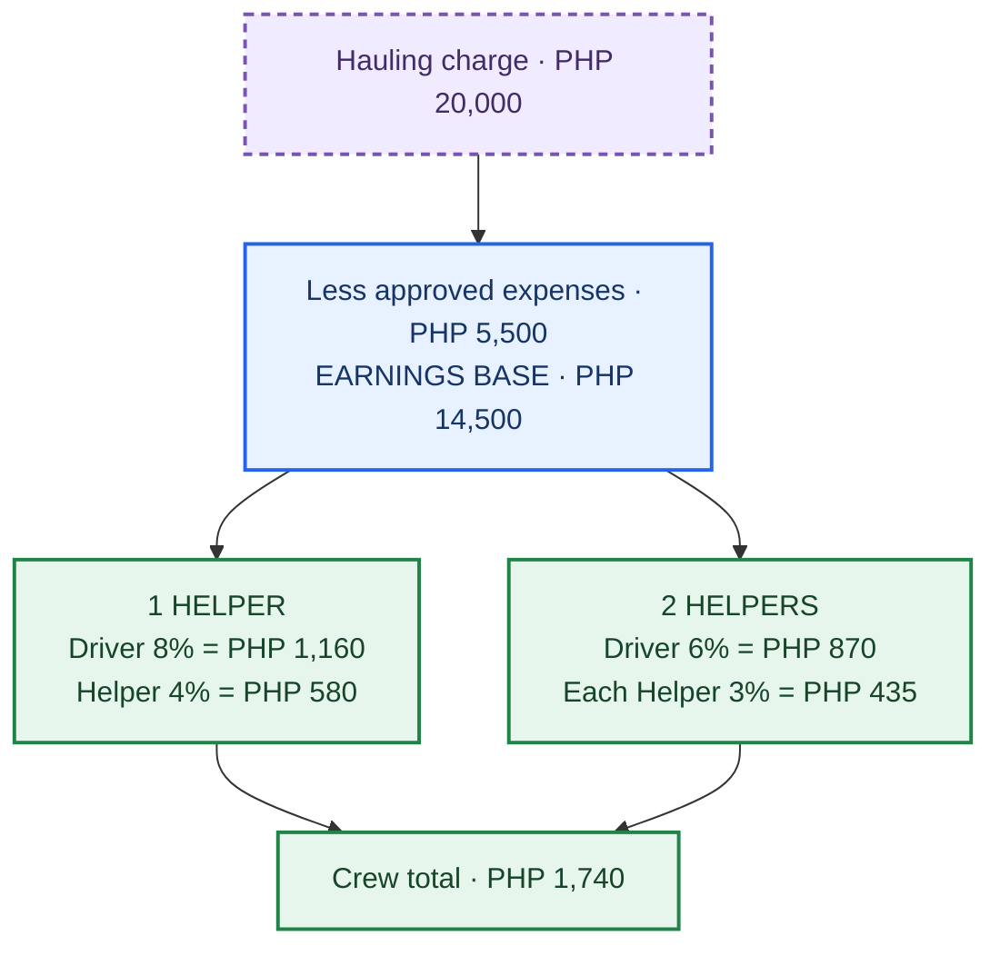
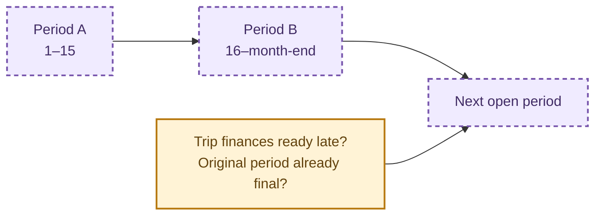
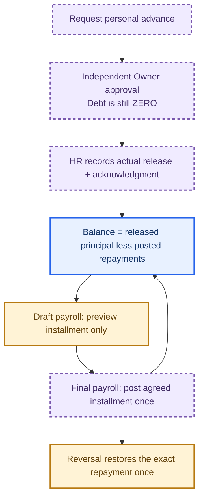
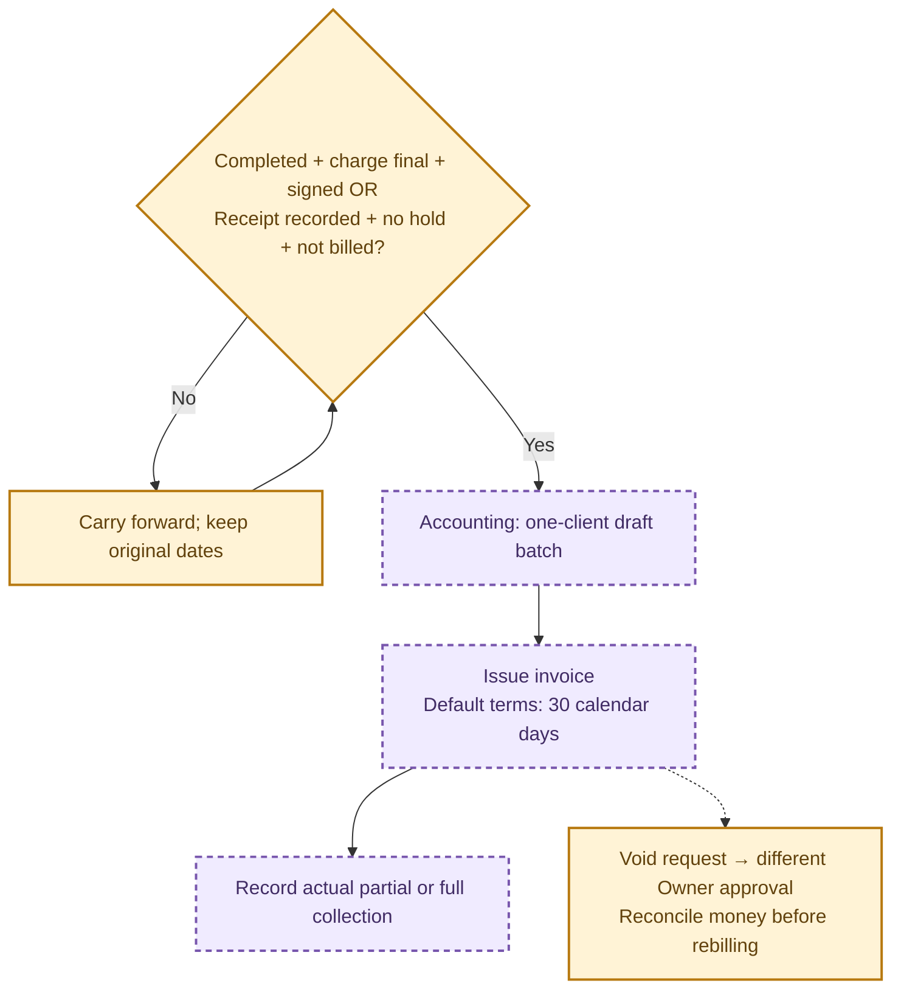

# Financial working policies

[Index](../README.md) · [Role manuals](../runbooks/roles/README.md)

> **PLANNED — not live financial processing.** Version 1, 18 November 2026. These user-authorized working policies fill D4–D10. Real payroll still requires D16 legal review.

**Trip completion feeds independent planned payroll and client billing workflows.**



## Seven decisions at a glance

| Decision         | Working rule                                                      |
| ---------------- | ----------------------------------------------------------------- |
| D4 · Expenses    | Evidence + independent approval; missing expenses never mean zero |
| D5 · Charge      | Final agreed fixed charge per trip; recorded reference            |
| D6 · Percentages | 8/4 or 6/3/3; future-dated versions locked at departure           |
| D7 · Rounding    | Decimal centavos, half-up; negative base goes on hold             |
| D8 · Payroll     | Semi-monthly; approved personal deductions after gross            |
| D9 · Advances    | Debt starts on release; repayments follow an agreed schedule      |
| D10 · Billing    | Eligible unbilled trips, monthly cutoff, default 30-day terms     |

## 1. Shared controls

**No self-approval. No silent rewrites. No duplicate postings.** Keep money and operational states separate.

<details>
<summary><strong>Full policy, controls and edge cases</strong></summary>

- Use PHP and fixed decimal precision; accept decimal strings and store monetary values as fixed-precision decimals. Never calculate money with binary floats.
- Every mutation records actor, timestamp, reason/reference and audit trace. Finalized values are immutable; corrections create linked reversals/adjustments.
- No one approves an entry they entered or one concerning their own pay/advance, even with combined roles. The Owner has no self-approval bypass. If no independent authorized approver exists, the record remains pending.
- Each issuance, earnings generation, release, repayment, payroll finalization and payment operation needs an idempotency key plus database uniqueness constraints. UI disabling alone is insufficient.
- Keep operational completion, expense readiness, earnings readiness, payroll state, billing readiness, invoice state and payment state separate.
- Store business cutoffs in Asia/Manila and event timestamps in UTC. Payment records must contain actual amount, date, method and reference; no bank/payment-provider transfer is implied.

</details>

## 2. D4 — Expense entry and approval

**Fuel/toll first.** Other categories need the specified policy; an empty expense list is not a zero declaration.

**Fuel/toll first. Other categories need the specified policy; an empty expense list is not a zero declaration.**



<details>
<summary><strong>Full policy, controls and edge cases</strong></summary>

**Enterers:** Dispatcher and Owner for permitted trips; assigned Driver for their own trips. **Approvers:** Accounting or an independent Owner. Driver submissions always await review; nobody approves their own entry. HR, Fleet and Helper cannot enter or approve expenses under the current matrix.

Allowed deductible categories: actual trip fuel, route toll, documented parking/weighbridge fees, and a separately justified trip-specific handling charge. The latter categories require an explicit Owner-approved category policy before enabling them. Until then, enable fuel/toll only. Exclude personal spending, penalties charged to an employee, personal advances, payroll deductions, general overhead and vehicle capital/maintenance costs from automatic trip deductions.

Each line records trip, category, positive amount, description, incurred date, entered-by/time and review state. Require receipt evidence for fuel/toll. Where evidence is genuinely unavailable, retain an explanation and independent Owner exception; do not silently approve. Rejected lines are returned with a reason; corrected submissions require fresh review.

Workflow: **Entering → Awaiting review → Finalized**. Finalize only when all included deductible lines are approved and no disputed submitted lines remain. **Confirmed zero** requires an explicit zero submission and a different authorized reviewer's confirmation. An empty list is never zero. Editing an approved draft invalidates its approval; finalized expenses require adjustment/reversal and an earnings impact review.

Operating advances are tracked separately: releasing fuel money is not an expense. Record actual purchases once, reconcile unused returned money and investigate shortages independently.

</details>

## 3. D5 — Hauling charges

**Accounting/Owner finalizes the trip charge.** Rate differences require independent Owner review.

<details>
<summary><strong>Full policy, controls and edge cases</strong></summary>

Use a **fixed agreed charge per trip** as the first supported basis. Accounting or Owner records/finalizes a positive charge with a quotation, agreement or documented instruction reference. A future client rate card may suggest a default; the finalized trip charge is an explicit decision, not a calculation from payroll percentages.

Only Owner/Accounting see commercial rates and charge details. Record the agreed reference amount, final amount and variance reason; any variance requires an independent Owner review before financial finalization. If the Owner entered the variance, a different authorized Owner reviews it. Missing agreements/charge values hold earnings and billing readiness; they do not reopen the operational trip.

Corrections after earnings or invoice finalization require linked adjustments/credit treatment, never silent editing. No tax calculation, withholding, tax invoice certification or official receipt issuance is assumed by this policy; define those with Accounting before adding them.

</details>

## 4. D6 — Percentages and effective dates

**Percentages apply to the earnings base itself.** Later rule changes never rewrite finalized earnings.

**Percentages apply to the earnings base itself. Later rule changes never rewrite finalized earnings.**



<details>
<summary><strong>Full policy, controls and edge cases</strong></summary>

Owner configures versioned percentage rules. Initial defaults: driver + one helper = **8% / 4%**; driver + two helpers = **6% / 3% / 3%**. These are percentages of the earnings base, not of a 12% pool.

Changes take effect at **00:00 Asia/Manila on a future date**. Select the version at actual departure and retain its ID/rates with the trip's financial snapshot. Changing an order date does not change the chosen version. Trips already departed retain their version even if earnings are calculated later. No retroactive rewrite; authorized corrections use adjustments.

One original earning row per employee per trip, with unique employee/trip constraint. Capture crew membership, finalized charge, approved expense total, rule version, individual percentage and resulting amount. Finalizing earnings requires Completed + finalized charge + finalized or confirmed-zero expenses.

</details>

## 5. D7 — Rounding and negative values

**Charge − approved expenses = base.** Round each employee result to centavos; hold negative outcomes.

| Crew        | Driver    | Helper 1 | Helper 2 | Total     |
| ----------- | --------- | -------- | -------- | --------- |
| One Helper  | PHP 1,160 | PHP 580  | —        | PHP 1,740 |
| Two Helpers | PHP 870   | PHP 435  | PHP 435  | PHP 1,740 |

Example: PHP 20,000 charge − PHP 5,500 expenses = PHP 14,500 base.

<details>
<summary><strong>Full policy, controls and edge cases</strong></summary>

Calculate using decimal arithmetic; round each employee's final gross amount to **two decimal places using ROUND_HALF_UP**. Total crew earnings is the sum of those rounded individual amounts. Record any difference from the separately rounded total crew percentage as rounding variance; do not silently allocate it to one helper. Reject zero/negative expense and payment entries; explicit reversals use linked operations, not disguised negative ordinary transactions.

```text
base = final charge - approved deductible expenses
individual gross = round_half_up(base × individual percentage, 0.01)
net pay = gross earnings - approved personal deductions - agreed advance repayments
```

Example: ₱20,000 − ₱5,500 = ₱14,500 base. One helper: Driver ₱1,160 and Helper ₱580. Two helpers: Driver ₱870 and each Helper ₱435. Total ₱1,740 in either case.

Negative base creates an **Owner review hold** and no payable negative earnings. Zero base creates explicit zero earnings only after the financial information has been finalized. Neither affects operational completion. If personal deductions would exceed payable earnings, hold payroll and carry forward only according to the approved arrangement; never invent employee debt or produce negative net pay.

</details>

## 6. D8 — Payroll periods, deductions and adjustments

**Periods: 1–15 and 16–month-end.** A draft previews repayments; finalization posts them once.

**Periods: 1–15 and 16–month-end. A draft previews repayments; finalization posts them once.**



<details>
<summary><strong>Full policy, controls and edge cases</strong></summary>

Use semi-monthly periods **1–15** and **16–month-end**, inclusive, Manila time. Attribute original earnings to the trip's receipt-confirmed business date. If readiness arrives after that period is finalized, include an identified carry-forward earning in the next open period with its original trip/date. Never reopen a finalized period silently. Payment date remains the actual release date.

HR prepares payroll, itemized deduction proposals and adjustments. Owner reviews deductions/adjustments independently. HR records actual payroll payment; the Owner can inspect but has no `payroll_payment.record` grant by default. Draft statements preview repayments without changing advance balances. Finalization commits earnings allocation, approved deductions and repayment ledger entries together; retries cannot repeat them.

Development deduction categories are **documented payroll-overpayment recovery** and **an employee-requested voluntary deduction**, each requiring a specific recorded basis, written authorization and independent Owner approval. A generic category name is not authority to deduct from pay. Keep these disabled for real payroll until D16 review validates their use and limits. Personal advance repayments follow their own D9 ledger rather than an ordinary deduction category. Fines, damage, operating shortages, attendance penalties, taxes, statutory contributions and salary/benefit adjustments are not automatically permitted; they are outside the defined scope.

Every authorized deduction needs employee, type, reason, amount, period, evidence/consent where required, creator and independent approval. Fuel/toll already deducted from the earnings base cannot be deducted again personally. Finalized corrections are separately approved adjustments. A payroll reversal must atomically reverse its repayment allocations and reconcile any actual payments; never delete evidence of money already disbursed.

Statements show each trip/rate/gross, gross total, each deduction, repayment, net pay, remaining advance balance, actual payments and unpaid balance. Example: ₱6,000 gross − ₱300 approved deduction − ₱1,000 agreed repayment = ₱4,700 net (illustration only, not authorization for a deduction).

</details>

## 7. D9 — Advances and repayments

**Approved is not released.** Only actual personal funds released count as debt; operating advances stay separate.

**Approved is not released. Only actual personal funds released count as debt; operating advances stay separate.**



<details>
<summary><strong>Full policy, controls and edge cases</strong></summary>

Driver/Helper may request their own personal advance; HR can prepare a request for an employee. Owner independently approves a maximum amount and repayment schedule; HR records actual release and employee acknowledgment. Approval alone creates **zero debt**. Partial releases increase principal only by the released amount. Approval and release must be performed by different people.

Initial repayment model: a **fixed peso amount per payroll period**, explicit start period and employee acknowledgment; no interest or penalties. Deduct the smaller of agreed installment, outstanding released balance and available pay after lawful approved deductions. If insufficient pay remains, apply only the permissible amount and carry the rest forward without an automatic enlarged next installment. Changes require a new documented arrangement. Do not deduct the full balance without an explicit approved full-repayment arrangement.

Apply repayments only when payroll finalizes. Store a unique advance/payroll repayment allocation. Reversal restores the exact balance once. Settlement occurs only when released principal minus posted repayments/valid reversals is zero. Preserve approval, releases, acknowledgment, repayments and adjustments independently.

Operating advance workflow: authorize trip funds → record release → record actual expenses → record unused returns → independently review reconciliation. A shortage creates a review item, not personal debt. Do not book both the advance and purchase as deductible expenses.

</details>

## 8. D10 — Billing readiness, cutoffs and collections

**Bill eligible trips, even across orders/periods.** Unready work carries over without changing its delivery date.

**Bill eligible trips, even across orders/periods. Unready work carries over without changing its delivery date.**



<details>
<summary><strong>Full policy, controls and edge cases</strong></summary>

Use monthly batches with cutoff **23:59:59 Asia/Manila on the last calendar day**. Accounting can create a later batch for eligible carry-over. Each batch belongs to one client, may contain multiple orders/periods, and preserves actual trip delivery dates.

A charge is ready when: trip is Completed, active signed OR exists, receipt is recorded, charge is finalized, no charge dispute/correction hold exists, and it is not allocated to another active bill. Stamped copy and whole-order completion are not requirements. Expense/payroll finalization and employee payment are not billing prerequisites. Unready trips remain pending; they do not block other eligible charges.

Accounting builds a Draft, verifies selected lines and issues the invoice. Each trip charge can be in at most one active bill, enforced under a database lock/unique allocation. Issued invoice lines are immutable. An Accounting void request needs a different Owner's approval; do not automatically release a paid invoice's charge for rebilling. Resolve linked collections/credits/refunds before an approved reversal. All changes are audited.

Default payment terms: **30 calendar days from issue**, with any client-specific override recorded before issue. Record partial/full collections with date, method, reference and allocation. Prevent allocation above outstanding amount; unmatched excess remains an explicitly recorded unallocated credit for Accounting review. Payroll deductions and crew expense shares never reduce the client's agreed charge.

</details>

## 9. Decisions still outside these defaults

**Still unresolved:** D1–D3 and D11–D17; this financial policy does not silently decide them.

<details>
<summary><strong>Full policy, controls and edge cases</strong></summary>

D1 OR title/helper upload authorization; D2 post-departure crew changes; D3 failed/partial-work compensation; D11–D14 production vendors/hosting/reviewer/outbox; D15 any future dispatch override; D16 legal validation; D17 devices/MFA/recovery. Current helper-upload flag stays off, crew changes lock after departure and the outstanding-OR block has no override.

</details>

## 10. Implementation acceptance checks

**Prove the money rules with tests before finance is marked live.**

<details>
<summary><strong>Full policy, controls and edge cases</strong></summary>

Before marking finance live, prove: missing expenses never equal zero; no self-approval with combined roles; sample percentages match; historical rates do not change; negative base/pay hold; one original employee/trip earning; draft payroll does not repay advances; approved but unreleased advances create no debt; partial release/repayment/reversal remain exact; client nonpayment does not block earnings; one active bill per charge; old trips carry over unchanged; operational completion remains independent. Cover concurrent retries on PostgreSQL and role/field/ownership access, not only happy-path calculations.

</details>
