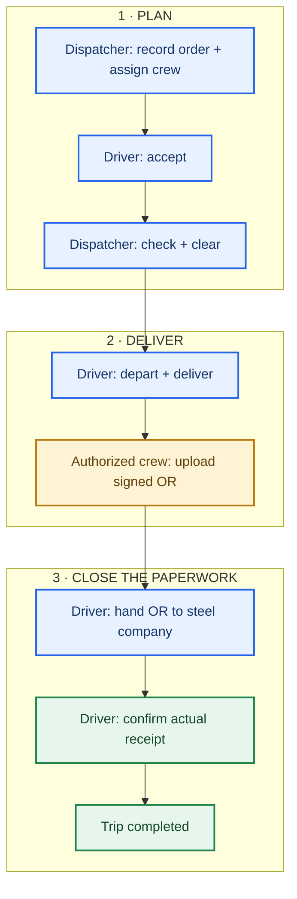
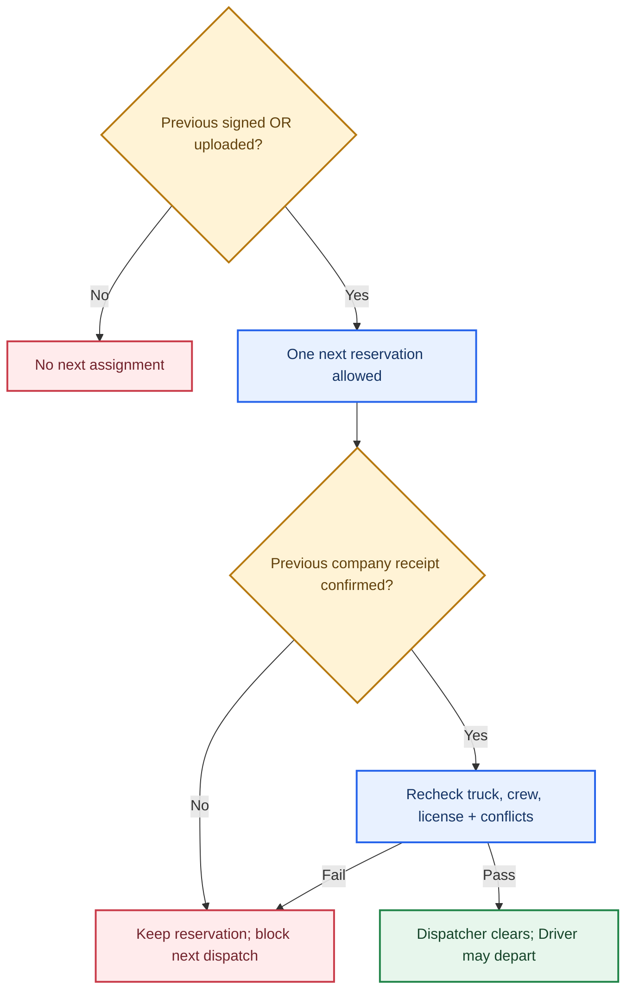

# Try one delivery, step by step

[Handbook](../README.md) · [Detailed feature guide](user-guide.md) · [Test results](verification.md)

**Goal:** take one test order from Pending to Completed while using the correct role at every step. Use a fictional client and route, and prefix test references with `DEMO`. Test records stay in the local database history.

**Plan the order, deliver the load, then close the paperwork.**

## 1. Open the system

| Open     | Address                             | Use it for                       |
| -------- | ----------------------------------- | -------------------------------- |
| Frontend | <http://localhost:5173>             | Normal work and this walkthrough |
| FastAPI  | <http://localhost:8000/api/v1/docs> | Developer API reference          |

Use [local setup](development.md#4-local-setup) if services are not running. For the configured Docker development stack, `docker compose up -d --build backend frontend` builds/starts the apps and applies migrations; it is not a production deployment. Use provisioned development/staging accounts and check **My account** before acting. Do not put credentials or inbox codes into documentation.

The presentation seed is a separate explicit command in [presentation setup](sprint-5-6.md#presentation-dataset). It adds labelled, fictional records without creating Clerk logins; you cannot sign in as a seeded DEMO Driver/Helper without separately provisioning and linking an authorized development identity.

> **Switching roles:** use separate browser profiles or sign out before signing into the next account. The role picker at `/preview.html` is a sample design tool; use the main frontend for saved records.

## 2. Prepare once

| Who signs in  | Navigate                          | Do this                                                                   | Ready when                                             |
| ------------- | --------------------------------- | ------------------------------------------------------------------------- | ------------------------------------------------------ |
| HR or Owner   | **People → Add employee**         | Create missing crew records; reuse existing demo accounts where available | One Driver and one or two Helpers exist                |
| Owner         | **People → employee action menu** | Check **Roles**, **Link sign-in account**, and **Activate** as needed     | Crew are active; Driver has a linked Clerk identity    |
| Fleet Manager | **People → Driver license**       | Save a valid license number and expiry                                    | Driver is eligible on the trip date and departure date |
| Fleet Manager | **Fleet → Register truck**        | Create an available test truck with sufficient capacity                   | Truck is active and outside maintenance                |

Helpers need a linked account only if they will perform app actions. Existing assignments or outstanding ORs can make an otherwise valid person unavailable.

## 3. Run the delivery

Use a **10-ton order** and a truck with capacity of **at least 10 tons** for a simple one-trip example.

| Step | Sign in as                           | Navigate and act                                                                                                           | Expected result                                                     |
| ---- | ------------------------------------ | -------------------------------------------------------------------------------------------------------------------------- | ------------------------------------------------------------------- |
| 1    | Dispatcher                           | **Clients → New client**; add a fictional client or reuse an appropriate test client                                       | Client is selectable                                                |
| 2    | Dispatcher                           | **Delivery orders → New order**; choose client, pickup, destination, date and 10 tons                                      | Pending order                                                       |
| 3    | Dispatcher                           | **Dispatch → Assign trip**; choose the order, truck, 10 tons, one Driver and one or two Helpers                            | Scheduled trip                                                      |
| 4    | Assigned Driver                      | **My trips → Accept trip**                                                                                                 | Accepted                                                            |
| 5    | Dispatcher                           | Reopen **Dispatch**; on that card select **Clear for dispatch**                                                            | Cleared for dispatch                                                |
| 6    | Assigned Driver                      | Reopen **My trips → Record departure**                                                                                     | In transit                                                          |
| 7    | Assigned Driver                      | **My trips → Record delivery** after the simulated delivery                                                                | Delivered — OR Pending                                              |
| 8    | Driver or authorized assigned Helper | **My trips → Signed OR**; select a JPEG/PNG up to 5 MB → **Upload**                                                        | OR Uploaded                                                         |
| 9    | Assigned Driver                      | After the simulated physical OR handover, **My trips → Confirm company receipt**; enter receipt time → **Confirm receipt** | Completed                                                           |
| 10   | Dispatcher or Owner                  | Reopen **Dispatch** and **Dashboard**; Owner can also inspect **Audit log**                                                | Completed trip; resource availability reflects any next reservation |

Step 9's section is visible only when the trip and your access allow confirmation. Use the actual receipt time in real work. A stamped copy is optional. A fully fulfilled 10-ton order completes; an order with remaining work can stay in progress.

**Refresh or reopen the page after another role acts.** The app does not push every other user's change to an already open screen.

> **Important:** Owner alone has read access to clients/orders. Use Dispatcher for steps 1–3; an Owner who enters orders also needs the Dispatcher role. Only the assigned Driver can accept, depart, deliver and confirm receipt.

## 4. Try the dispatch restriction

**A signed OR permits a next reservation, while receipt confirmation is required for dispatch.**

On a separate test delivery, pause after **OR Uploaded**:

- [ ] Dispatcher can reserve **one next trip** with the same resources if all other checks pass.
- [ ] Assigned Driver can accept that reserved trip.
- [ ] Dispatcher attempts **Clear for dispatch**: it must be blocked by the previous unconfirmed receipt.
- [ ] Assigned Driver returns to the previous trip and confirms company receipt.
- [ ] Dispatcher reopens the board and clears the next trip; current eligibility must still pass.

Do not confirm a real receipt merely to remove a block. If your test reservation will not run, Dispatcher can cancel it before departure with a reason.

## 5. Where the other roles fit

| Role            | Daily navigation                                                                                                 |
| --------------- | ---------------------------------------------------------------------------------------------------------------- |
| Owner / Manager | **Dashboard → People → Permissions → Audit log** for oversight and access; **Dispatch** for permitted exceptions |
| Dispatcher      | **Clients → Delivery orders → Dispatch**                                                                         |
| Fleet Manager   | **Fleet** for trucks/maintenance; **People → Driver license** for licenses                                       |
| Driver          | **My trips** for acceptance, departure, delivery, OR and receipt                                                 |
| Helper          | **My trips** for assigned deliveries and authorized OR uploads; no Driver progress or receipt actions            |
| HR and Payroll  | **People** for employee details; **Payroll / Cash advances / Reports** for persistent financial work             |
| Accounting      | **Clients / Delivery orders** for reads; **Trip expenses / Billing / Reports** within Accounting’s remit         |

## 6. Continue through fictional finance

Use a dedicated development/staging scenario. Seeded records are also available for read-only presentation, but their counts/states can change if you edit them. Do not treat DEMO amounts as actual business records.

| Step | Role                                 | Action                                                                                                                          | Expected result                                                                             |
| ---- | ------------------------------------ | ------------------------------------------------------------------------------------------------------------------------------- | ------------------------------------------------------------------------------------------- |
| 1    | Assigned Driver, Dispatcher or Owner | **Trip expenses → Add an expense line** with fictional fuel/toll evidence, or **Declare zero expenses**; **Submit for review**. | Entering → Awaiting review; missing data never equals zero.                                 |
| 2    | Independent Accounting/Owner         | **Review declaration**; approve or return with a reason.                                                                        | Finalized expenses or Confirmed zero; no contributor/beneficiary approves.                  |
| 3    | Accounting/Owner                     | **Finalize agreed hauling charge** with matching agreed/final values. Send a variance to a different Owner.                     | Financial readiness; automatic individual earnings after all prerequisites.                 |
| 4    | HR                                   | **Payroll**: inspect earnings; prepare a closed 1st/16th-start period and review statements.                                    | Draft previews installments without posting debt repayment; late earnings carry forward.    |
| 5    | HR                                   | **Finalize reviewed payroll**, then record only a simulated payment explicitly labelled DEMO.                                   | Once-only allocations/repayments and a recorded payment, not an actual transfer.            |
| 6    | Accounting                           | **Billing → Build client billing batch** for ready trips, review lines and **Issue reviewed invoice**.                          | One active allocation per charge; payroll finalization is not required for billing.         |
| 7    | Accounting                           | Record only a fictional collection explicitly labelled DEMO; inspect balances.                                                  | Invoice and payment position stay separate; excess credit is explicit.                      |
| 8    | Owner and each role                  | **Reports**; compare own/remit-limited views.                                                                                   | Owner oversight, HR payroll, Accounting billing, crew-owned records; no cross-role leakage. |

A current period cannot finalize before its last Manila business day ends; use the existing seeded closed-period presentation rather than falsifying a real trip date. Personal deductions stay disabled pending D16, and no real financial use is approved by this exercise. For exact commands, advances, retries and correction limits, use the [financial procedures](user-guide.md#10-dashboard-audit-permissions-and-finance).

<strong>If a step is missing or blocked</strong>

| Symptom                | Check                                                                                                      |
| ---------------------- | ---------------------------------------------------------------------------------------------------------- |
| Wrong or missing menu  | **My account** role/capabilities; Owner checks employee access                                             |
| No trip under My trips | Correct assigned Driver/Helper account; refresh after assignment                                           |
| Cannot assign          | Remaining load, truck capacity/maintenance, active crew, Driver license/account and existing commitments   |
| Cannot depart          | Driver accepted; Dispatcher cleared; previous receipt confirmed; resources still eligible                  |
| Upload fails           | Real JPEG/PNG, at most 5 MB; configured private Supabase bucket; retry after resolving the displayed error |
| No receipt button      | Assigned Driver, signed OR successfully stored, eligible trip status                                       |
| Blank sign-in screen   | Browser network access to Clerk, developer-console errors, correct local frontend configuration            |

See [feature troubleshooting](user-guide.md#11-troubleshooting-and-interrupted-operations) for recovery. Do not disable authentication or change roles to bypass a workflow restriction.

