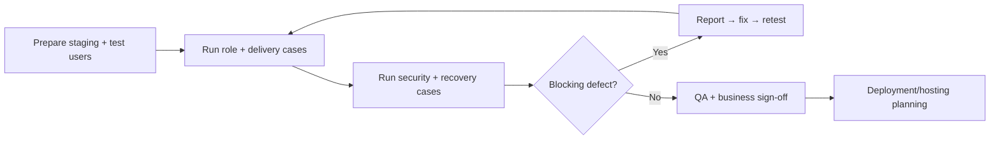

# QA acceptance and deployment gate

[Runbooks](README.md) · [Delivery walkthrough](delivery-walkthrough.md) · [Security review](../decisions/security-hardening.md) · [Verification](verification.md)

**Use this checklist to decide whether the operational system is ready for hosting.** Automated results are supporting evidence; QA must record its own manual results. All cases below start **Not run** for the QA team.

## 1. Prepare the test session

- [ ] Record branch, commit SHA, environment URL, browser/device, tester and date. Use the staged changes' eventual commit SHA once committed.
- [ ] Use a dedicated local or staging database, private test storage bucket and Clerk development/staging accounts. Create fictional clients, routes, plates and documents prefixed `QA-`.
- [ ] Prepare seven roles, plus a second Driver, a second crew, an inactive account and an unlinked Clerk account. Verify each person's roles under **My account**.
- [ ] Use separate browser profiles for Dispatcher, Driver and Owner; refresh after another role acts.
- [ ] Prepare a valid JPEG, PNG, renamed non-image, corrupt image and file larger than 5 MB. Use mock documents, never real signatures or customer details.
- [ ] Record the configured limits from the [security review](../decisions/security-hardening.md#request-budgets). Do flood/recovery tests only in the dedicated test environment.
- [ ] Confirm frontend `/`, API `/api/v1/health` and development API docs respond. On this workstation use `http://localhost:5173` and `http://localhost:8000/api/v1/docs`.

The normal sequence is described in the [guided walkthrough](delivery-walkthrough.md). This document adds rejection, permissions, retry and release checks.

## 2. Role and access checks

Test direct API access as well as menus. A hidden button alone is insufficient. Never paste bearer tokens or passwords into the QA report; use temporary session tokens only inside your local API client.

| ID  | Role / action                                                                                       | Expected result                                                                                                                                           |
| --- | --------------------------------------------------------------------------------------------------- | --------------------------------------------------------------------------------------------------------------------------------------------------------- |
| A01 | All seven accounts sign in; open **My account** and each permitted sidebar page                     | Correct identity and roles; no unrelated private employee information or browser errors                                                                   |
| A02 | Missing/expired/invalid token calls a protected API                                                 | `401`; stable error code and trace ID, no database/stack details                                                                                          |
| A03 | Inactive or unlinked account signs in                                                               | No operational access; clear account-setup/activation message                                                                                             |
| A04 | Owner opens **People → Roles / Link sign-in account / Activate**, **Permissions** and **Audit log** | Authorized controls work; changes recorded in audit                                                                                                       |
| A05 | Each non-Owner calls `/api/v1/permission-matrix`                                                    | `403`; no role matrix contents                                                                                                                            |
| A06 | Dispatcher creates clients/orders; Owner-only account attempts the same writes                      | Dispatcher succeeds; Owner-only account is denied unless also assigned Dispatcher                                                                         |
| A07 | Fleet opens **People → Driver license**                                                             | Can save eligible Driver license; cannot access employee email/account/role fields outside its projection                                                 |
| A08 | HR edits employee contact details, then attempts role/link/activation changes                       | Allowed details save; Owner-only changes denied                                                                                                           |
| A09 | Driver 2 attempts Driver 1's trip progress, OR list and signed URL                                  | No record access (`403`/`404` as appropriate); no signed link leaks                                                                                       |
| A10 | Helper views assigned trip, then tries progress and receipt confirmation                            | Assigned trip visible; Driver-only actions denied. Upload denied when Helper upload flag/grant is disabled; allowed for assigned Helper only when enabled |
| A11 | Accounting views clients/orders, then attempts crew progress or another employee's payroll          | Permitted operational reads only; unauthorized writes/private records unavailable; finance pages stay previews                                            |

## 3. Operational workflow checks

| ID  | Steps                                                                                                                                                           | Expected result                                                                                     |
| --- | --------------------------------------------------------------------------------------------------------------------------------------------------------------- | --------------------------------------------------------------------------------------------------- |
| W01 | Prepare active linked Driver, 1–2 active distinct Helpers, valid license and available truck; create 10-ton order; assign 10-ton trip                           | Pending order → Scheduled trip; correct crew/truck and route                                        |
| W02 | Attempt truck over-capacity, excess remaining order load, duplicate crew, wrong-role crew, inactive crew, expired license, unlinked Driver or maintenance truck | Assignment rejected with a useful reason; no partial trip/resource updates                          |
| W03 | Driver accepts → Dispatcher clears → Driver departs → Driver records delivery                                                                                   | Accepted → Cleared for dispatch → In transit → Delivered — OR Pending                               |
| W04 | Attempt departure before acceptance/clearance, delivery before departure, or repeat a milestone                                                                 | Rejected; no skipped states or duplicate progress                                                   |
| W05 | After assignment, expire license/deactivate crew/reduce truck capacity in separate test cases; attempt clearance and departure                                  | Current eligibility rechecked at both gates; unsafe dispatch rejected                               |
| W06 | Upload valid signed OR using assigned Driver; open issued document link                                                                                         | OR Uploaded; real private storage object exists, authorized signed link opens                       |
| W07 | Before prior signed upload, attempt next assignment using shared resources                                                                                      | Blocked; the prior trip is identified                                                               |
| W08 | After signed upload but before receipt, reserve one next trip; attempt another reservation and next clearance                                                   | One reservation allowed if eligible; extra reservation rejected; next dispatch blocked              |
| W09 | Prior Driver confirms actual company receipt after physical handover                                                                                            | Prior trip Completed; next reservation preserved; next clearance now possible if eligibility passes |
| W10 | Fulfill only part of an order, then fulfill the full remaining load                                                                                             | Partial order remains in progress; fully fulfilled order completes                                  |
| W11 | Change Driver before departure                                                                                                                                  | New Driver must accept again; prior clearance does not carry over                                   |
| W12 | Replace truck before departure or in transit; mark original as needing maintenance                                                                              | Same trip continues; replacement eligibility checked; original maintenance state retained           |
| W13 | Cancel before departure, fail eligible trip after departure; omit reasons once                                                                                  | Allowed transitions require reasons and audit entries; invalid transitions rejected                 |
| W14 | Complete maintenance after a simulated repair                                                                                                                   | Truck becomes eligible only if otherwise available; completion does not erase reservations          |

## 4. Documents, retries and corrections

| ID  | Steps                                                                                                                                | Expected result                                                                                            |
| --- | ------------------------------------------------------------------------------------------------------------------------------------ | ---------------------------------------------------------------------------------------------------------- |
| D01 | Upload JPEG and PNG; inspect sanitized stored output                                                                                 | Supported images save; EXIF/GPS metadata removed                                                           |
| D02 | Upload renamed text, corrupt image, oversized image/file and oversized request body                                                  | Invalid data rejected; no invalid document row/object retained                                             |
| D03 | Open bucket object without authorization; wait beyond signed URL lifetime and retry link                                             | Private object inaccessible directly; expired link fails; authorized user can request a fresh link         |
| D04 | Confirm receipt without a stored signed OR; use wrong Driver; use future/before-delivery receipt time                                | Rejected with state/ownership/time validation                                                              |
| D05 | Confirm with one `Idempotency-Key`; repeat identical request/key                                                                     | One completion and one receipt audit event; same key safely replays                                        |
| D06 | Confirm again with another key after completion                                                                                      | Conflict; no second completion/payment-like side effects                                                   |
| D07 | Owner corrects mistaken receipt with reason before later departure                                                                   | Reopens prior trip; affected later clearance revoked; reservation retained                                 |
| D08 | Attempt correction after a later shared-resource trip departed, including one now Completed/Failed or with truck replacement history | Correction blocked; history stays intact                                                                   |
| D09 | Simulate storage/API timeout or failed DB commit in isolated environment; retry                                                      | Clear error; no false success, duplicate active evidence, partial completion or orphaned permanent records |

## 5. Security and abuse checks

| ID  | Steps                                                                                                                             | Expected result                                                                                                                                               |
| --- | --------------------------------------------------------------------------------------------------------------------------------- | ------------------------------------------------------------------------------------------------------------------------------------------------------------- |
| S01 | Send bad/missing tokens 21 times from one peer with default settings                                                              | First 20 authentication failures; then `429`, `RATE_LIMITED`, `Retry-After: 60`; retry succeeds after the window with valid credentials                       |
| S02 | Temporarily set user API budget to 2 in isolated staging; make 3 valid `/me` calls as one employee, then call as another employee | First account: `200, 200, 429`; second account has its own budget if shared IP budget remains available                                                       |
| S03 | Temporarily lower IP budget; vary `X-Forwarded-For` on requests through the deployed entry point                                  | Header spoofing cannot create a new budget. Repeat against the actual proxy configuration, not only TestClient                                                |
| S04 | Lower upload user budget to 1; upload valid OR then submit another file immediately                                               | Second attempt returns `429` before image sanitization/storage; existing signed OR remains intact                                                             |
| S05 | Send concurrent calls and many distinct keys in automated limiter tests                                                           | Allowed count never exceeds budget; saturation preserves existing blocks, memory stays bounded; expired capacity recovers                                     |
| S06 | Exceed webhook budget; separately submit invalid signature, replayed webhook and oversized body                                   | Throttled requests return `429`; signatures/body limits enforced; replay does not duplicate mutations                                                         |
| S07 | Inspect success, auth-failure and throttled API responses                                                                         | Trace ID, `Cache-Control: no-store`, `X-Content-Type-Options: nosniff`, `X-Frame-Options: DENY`; no secret/stack/SQL output                                   |
| S08 | Preflight an unapproved origin; inspect deployed public bundle and attempts to fetch `/.env`, `/.git/HEAD`                        | No permissive CORS response; no secrets or repository files exposed; publishable Clerk key is intentionally public                                            |
| S09 | Run backend/frontend dependency audits and secret scanning on the final commit/history                                            | Record actual results; no unreviewed runtime Critical/High findings; development findings have a documented release decision                                  |
| S10 | Verify production runtime/proxy plan                                                                                              | No Vite dev server/public pgAdmin/database; TLS and frontend security headers configured; exact Clerk/CORS origins; shared rate controls for multiple workers |

Restore temporary rate limits after testing. Restart a test worker if configuration changes require it, then rerun normal workflow smoke checks.

## 6. Usability and recovery

- [ ] Desktop and a real phone: sign-in, menus, assignment details, OR capture/upload and receipt time input remain usable.
- [ ] Real test inbox verification works; development sign-in tickets are not evidence of real email delivery.
- [ ] Loading, empty, network error and permission-denied states offer clear next steps; refresh shows another user's changes.
- [ ] Reopening after interrupted upload/receipt does not claim success until the server confirms it.
- [ ] Backup a test database and restore into a separate database; compare trips, permissions, audit, document metadata and private-storage availability.
- [ ] Practice rollback using a separate environment; record migration compatibility, release version and restore/redeploy instructions.
- [ ] Record the expected concurrent user workload; exercise it in staging and attach latency/error/resource measurements. The current per-process limiter is not a multi-worker load test.

## 7. Financial scope and release decision

Expenses, payroll, advances, billing and expanded reports are **previews**. QA checks their labels and access, not real transaction processing. If the release requires financial processing, it is **blocked** until those services are implemented, tested and legally reviewed where required.

Deployment planning starts only when:

- [ ] Required operational/manual cases above have evidence and pass; failures are fixed and retested.
- [ ] No unresolved Critical/High application security defects or unapproved release blockers remain.
- [ ] Live private-storage, real-device/inbox, restore and rollback checks are recorded.
- [ ] Hosting architecture specifies database/network isolation, TLS, trusted proxies, shared rate limiting/worker count, logs/alerts and secret ownership.
- [ ] Financial preview exclusions are accepted in writing by the business Owner.
- [ ] QA lead and business Owner sign off on the exact commit and release scope; deployment is approved as a separate next step.

## 8. Copy this result record

| Field                               | Fill in                                                              |
| ----------------------------------- | -------------------------------------------------------------------- |
| Build / commit / branch             | Pending                                                              |
| Environment URL / database label    | Pending — no passwords                                               |
| Tester / reviewer / date / timezone | Pending — Asia/Manila                                                |
| Case ID / status                    | Not run / Pass / Fail / Blocked                                      |
| Test records / preconditions        | QA references only                                                   |
| Steps / expected / actual           | Pending                                                              |
| Evidence                            | Redacted screenshot, HTTP status/error code, trace ID or test output |
| Defect / severity / retest commit   | Pending                                                              |
| QA sign-off / business sign-off     | Pending                                                              |
| Release decision                    | Not approved until required gates pass                               |

**Latest execution: 18 November 2026 — release Blocked.** The [fresh QA report](qa-results-2026-11-18.md) records 66 requirements: 53 Pass and 13 Blocked, two fixed and retested Medium defects, dependency findings, cleanup, and the remaining live/manual/reviewer prerequisites. [Complete result records and redacted evidence](qa-evidence-2026-11-18/results.json) use the section 8 fields for every requirement. The acceptance checklist above is unchanged.

**Independent manual QA and business sign-off remain pending.** Desktop automation, development test-email verification, local restore/rollback and live private-storage evidence do not certify a real phone/inbox, deployed proxy, representative staging workload or human approval. Financial services remain previews; deployment is a separately approved next step. See [verification](verification.md) for historical developer checks and their limits.
