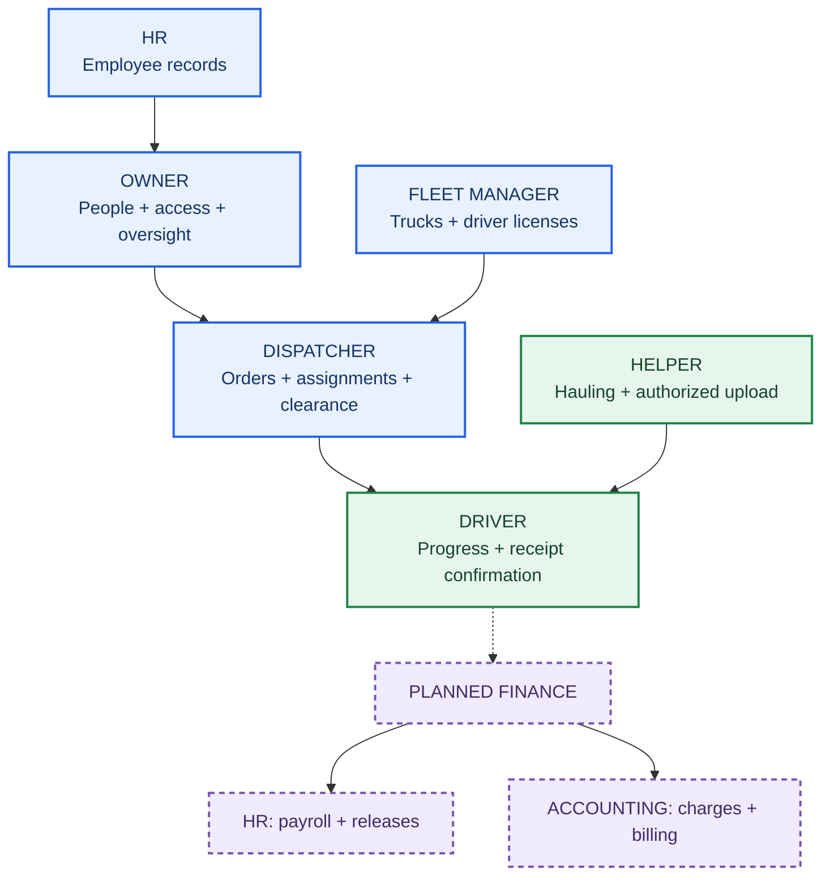

# Choose your role

[Documentation home](../../README.md) · [Feature guide](../user-guide.md)

One account can hold several approved roles. Start with the work you actually do.

**Owner, HR and Fleet prepare people/resources; Dispatcher assigns; Driver and Helper deliver; finance is planned.**

| I am responsible for…                  | My guide                            |
| -------------------------------------- | ----------------------------------- |
| People, permissions and oversight      | [Owner / Manager](owner-manager.md) |
| Orders, assignments and dispatch       | [Dispatcher](dispatcher.md)         |
| Trucks, maintenance and licenses       | [Fleet Manager](fleet-manager.md)   |
| Delivery progress and company receipt  | [Driver](driver.md)                 |
| Hauling support and authorized upload  | [Helper](helper.md)                 |
| Employee records and future payroll    | [HR and Payroll](hr-payroll.md)     |
| Future trip finance and client billing | [Accounting](accounting.md)         |

> **Roles do not bypass rules.** The backend also checks whose record it is and what state it is in. Owner alone cannot enter orders as Dispatcher or confirm receipts as Driver.

**Live:** operational records. **Preview:** invented financial examples. **Planned:** not yet implemented. Helpers without logins may still be recorded and assigned.
