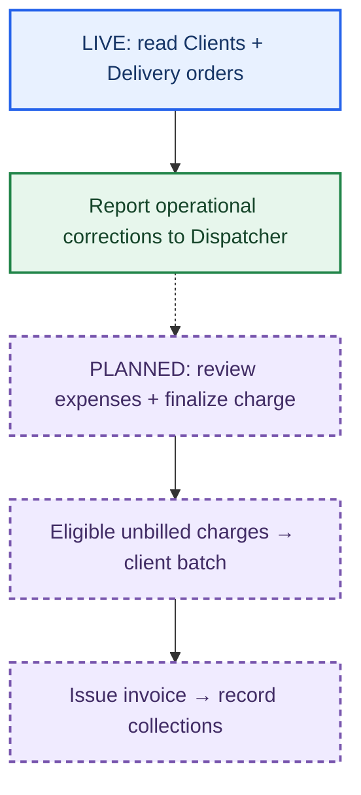

# Accounting

[All roles](README.md) · [Feature guide](../user-guide.md)

> **Your job:** Review permitted operational information; future billing stays separate from payroll.

**Accounting workflow. Review permitted operational information; future billing stays separate from payroll.**

## What can I use?

| Screen / area                | Your access                                             |
| ---------------------------- | ------------------------------------------------------- |
| Clients / Delivery orders    | Read-only review                                        |
| OR documents                 | Backend access by known reference; no dedicated browser |
| Expenses / Billing / Reports | Preview screens — no real financial records             |

## Quick checklist

- [ ] **Wrong operational detail:** Ask Dispatcher to correct it.
- [ ] **Need OR evidence:** Coordinate references with authorized operations staff.
- [ ] **Need to bill a client:** Use current external process; app billing is still preview.

> **Remember:** Accounting has no trip-list/Dispatch access and cannot read other employees’ payroll.

> **Finance status:** policies are defined; financial services are not implemented. Preview values are not real pay, debt or invoices.

## When you need the details

<strong>Current access</strong>

Read Clients and Delivery orders. The backend grants stored-OR viewing for a known trip/document reference, but Accounting has no trip-list grant or dedicated document browser today. Do not assume the Dispatch screen is available. Accounting cannot assign/clear trips, confirm OR receipt, read other employees' payroll or access the Owner audit log. Finance/report pages remain previews.

<strong>Current operational review</strong>

1. Open **Clients/Delivery orders**, search and inspect authorized request details.
2. Report operational corrections to Dispatcher rather than altering them through another account.
3. Coordinate evidence review and references with authorized operations staff. Developer/API support can use the authorized OR-document endpoints with your own session permissions; never request a storage service key.

<strong>Expense and charge workflow — planned</strong>

1. Review Driver/Dispatcher expenses and supporting evidence independently. Reject unsupported lines with a reason; do not approve your own submission.
2. Finalize an approved set or independently confirm an explicitly submitted zero-expense trip. Missing expenses remain unresolved.
3. Record/finalize the agreed fixed trip charge and its agreement reference. Submit variances for independent Owner review. Restrict rate information to Owner/Accounting.
4. Release financial readiness only when these controls pass; do not change operational completion to force financial processing.

<strong>Billing and collections — planned</strong>

1. At month-end select one client and eligible unbilled trip charges, including earlier carry-over. Preserve original dates; whole-order completion and stamped-copy upload are not prerequisites.
2. Exclude disputed/unready charges; other eligible trips can proceed. Verify the same charge is not on another active bill.
3. Review Draft lines/amounts/references, then issue. Default terms are 30 calendar days unless a recorded client agreement overrides them.
4. Record actual partial/full collections with date, method, reference and allocation. Do not reduce the client charge by crew payroll deductions or shares.
5. To void an issued invoice, request a separate Owner's approval and reconcile payments/credits before rebilling. Retain the audit trail and immutable issued amounts.

Expected future outcome: charges are billed once, old unready work carries forward, and collection status remains separate from employee pay. Follow [financial policies](../../decisions/financial-policies.md); do not issue the preview figures as real invoices.

[Troubleshooting](../user-guide.md#11-troubleshooting-and-interrupted-operations) · [Financial policies](../../decisions/financial-policies.md)
