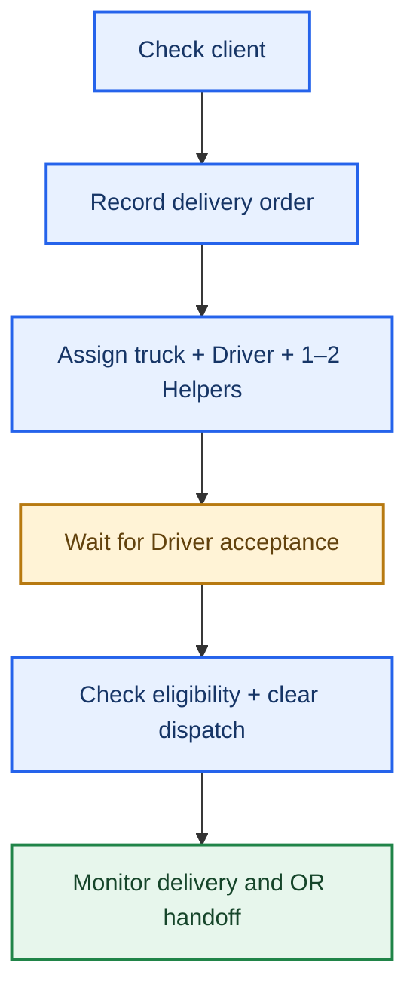

# Dispatcher

[All roles](README.md) · [Feature guide](../user-guide.md)

> **Your job:** Turn delivery instructions into an eligible, cleared trip.

**Dispatcher workflow. Turn delivery instructions into an eligible, cleared trip.**

## What can I use?

| Screen / area             | Your access                                   |
| ------------------------- | --------------------------------------------- |
| Clients / Delivery orders | Create and update permitted records           |
| Dispatch                  | Assign, clear, change crew/truck, cancel/fail |
| Fleet / People            | Read condition and limited license status     |

## Quick checklist

- [ ] **Before departure:** New Driver accepts again; helper change may require re-clearance.
- [ ] **Breakdown:** Replace truck on the same trip; mark maintenance if needed.
- [ ] **Blocked dispatch:** Read blocking trip → resolve with its Driver.

> **Remember:** OR upload allows a reservation. Company receipt is needed before the next dispatch.

## When you need the details

<strong>Responsibility and access</strong>

Record external delivery instructions, plan trips, monitor milestones, clear dispatch and manage assignment exceptions. View truck state and limited employee/license validity. No payroll of others, commercial rates, account administration or OR confirmation rights.

<strong>Process a request</strong>

1. Check the client under [Clients](../user-guide.md#4-clients); add/update when necessary.
2. Record [Delivery order](../user-guide.md#5-delivery-orders) with correct locations, scheduled date and metric tons.
3. Open [Dispatch](../user-guide.md#7-dispatch-and-assignment) and assign a suitable truck, one active licensed Driver and one or two active distinct Helpers. Split large orders into loads within capacity and remaining tonnage.
4. Ask Driver to **Accept trip**. After Accepted, select **Clear for dispatch**; resolve any blocking-trip/license/crew/capacity response.
5. Driver records departure and delivery. Monitor the board; it tracks events, not GPS.
6. After signed OR upload, you may reserve one next trip. Wait for the prior Driver's company-receipt confirmation before clearing/departing it.

Expected outcome: completed trips represent actual receipt confirmation, and reserved resources remain assigned correctly. Never treat an uploaded OR as company receipt or ask another person to sign in as the Driver.

<strong>Changes and exceptions</strong>

Use **Change crew** before departure; new Driver accepts again and changed helpers invalidate clearance. Use **Replace truck** before departure/in transit with reason; tell Fleet whether the original truck needs maintenance. **Cancel** before departure or **Mark as failed** in eligible post-departure states, with reasons. Do not create a second trip merely to replace a truck. Only Owner can correct receipt confirmation.

For license problems, open **People → License status** or refer to Fleet. For inactive crew, contact Owner. Capture blocking trip/trace references when escalating. Refresh/reopen the board to see other users' updates; only recent closed cards are shown.

<strong>Expenses — future workflow</strong>

You will enter supported trip expenses and evidence, then submit for independent Accounting/Owner review. You cannot approve your own expenses. Fuel operating advances are reconciled separately from actual fuel purchases. Today the expense page is a preview; follow the current external recordkeeping process until persistent services are delivered.

[Troubleshooting](../user-guide.md#11-troubleshooting-and-interrupted-operations) · [Financial policies](../../decisions/financial-policies.md)
