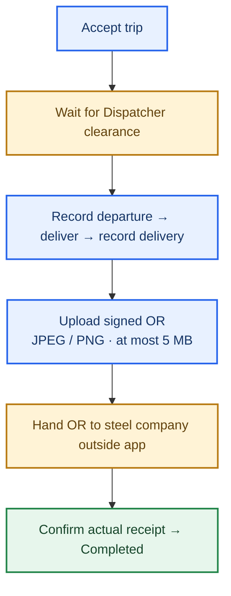

# Driver

[All roles](README.md) · [Feature guide](../user-guide.md)

> **Your job:** Accept your trip. Deliver. Record actual company receipt.

**Driver workflow. Accept your trip. Deliver. Record actual company receipt.**

## What can I use?

| Screen / area                     | Your access                                                                 |
| --------------------------------- | --------------------------------------------------------------------------- |
| My trips                          | Only your assigned deliveries                                               |
| Signed OR                         | Upload and view authorized evidence                                         |
| Confirm receipt                   | Your confirmation completes the trip                                        |
| Trip expenses                     | Enter/submit fuel/toll or explicit zero only for trips where you are Driver |
| Payroll / Cash advances / Reports | Own earnings/statements, personal advance requests and owned reports        |

## Quick checklist

- [ ] **Before leaving:** Check route/load/date → accept → wait for clearance.
- [ ] **After delivery:** Obtain signature → record delivery → upload.
- [ ] **After company handover:** Confirm real receipt time → check Completed.

> **Remember:** Acceptance is not departure clearance. Uploading the OR is not company receipt.

## When you need the details

<strong>Responsibility and access</strong>

Use your own active, linked sign-in. See only assigned trips and authorized own records. Accept your trip, record milestones, upload signed OR and confirm actual company receipt. You cannot clear dispatch, change crew/truck, view other employees' pay or approve expenses.

<strong>Complete a trip</strong>

1. Open **My trips**. Check pickup, destination, load and date. Report mistakes to Dispatcher before departing.
2. Select **Accept trip**. Wait for **Cleared for dispatch**; acceptance alone is not permission to depart.
3. Select **Record departure** at departure. If blocked, tell Dispatcher the displayed reason; do not bypass it with another account.
4. Deliver and obtain the receiving party's signature. Select **Record delivery**.
5. Open **Signed OR** and upload a clear JPEG/PNG of at most 5 MB. Wait for success and **OR Uploaded**.
6. Deliver the physical OR to the steel company for receipt outside the app.
7. Select **Confirm receipt**, enter/check the actual receipt time and submit. Confirm the trip is **Completed**.
8. Add **Stamped copy (optional)** when available; completion does not require it.

See [OR procedure](../user-guide.md#9-signed-or-stamped-copy-and-completion) for retries/files/time. Reopen document links through the app when expired. If you confirmed incorrectly, tell Owner immediately. Do not simply enter a second confirmation. A reserved next trip cannot depart until the preceding receipt is confirmed and Dispatcher clears it.

<strong>Exceptions and financial records</strong>

For a breakdown or crew issue, contact Dispatcher; replacement continues the same trip. For license details, ask Fleet to update them. If you cannot see the trip, refresh and verify the assignment with Dispatcher.

Use **Trip expenses** to enter your assigned trips’ fuel/toll lines or declare zero, then submit for independent review. Use **Payroll** to inspect your own earnings/statements, **Cash advances** to request your own personal advance, and **Reports** for your own records. These are persistent records; any `DEMO` values are fictional presentation data. Under [working policies](../../decisions/financial-policies.md), submit evidence for actual trip expenses; an independent person reviews them. Earnings use charge minus approved trip expenses, then your percentage. Personal repayments require an explicit approved arrangement; operating fuel advances are not automatic personal debt.

[Troubleshooting](../user-guide.md#11-troubleshooting-and-interrupted-operations) · [Financial policies](../../decisions/financial-policies.md)
