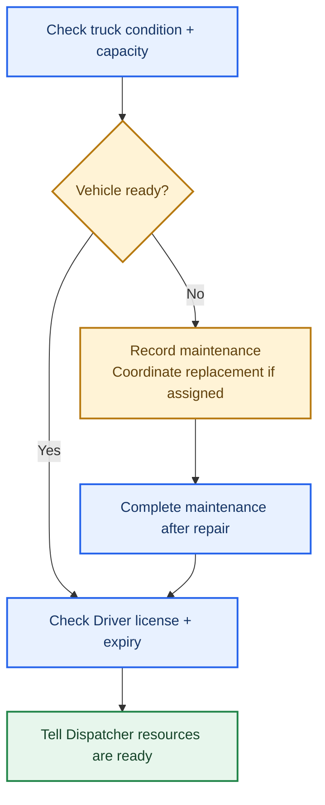

# Fleet Manager

[All roles](README.md) · [Feature guide](../user-guide.md)

> **Your job:** Keep trucks and Driver licenses ready for dispatch.

**Fleet Manager workflow. Keep trucks and Driver licenses ready for dispatch.**

## What can I use?

| Screen / area           | Your access                                |
| ----------------------- | ------------------------------------------ |
| Fleet                   | Register/edit trucks and maintenance       |
| People → Driver license | Save number and expiry                     |
| Limited employee list   | Select by name; private fields stay hidden |

## Quick checklist

- [ ] **Assigned truck breaks down:** Dispatcher replaces it; you manage repair.
- [ ] **Missing/expired license:** Update license → notify Dispatcher to recheck.
- [ ] **Wrong role or inactive person:** Ask Owner; Fleet cannot activate or assign roles.

> **Remember:** Trip completion never repairs a truck or closes its maintenance automatically.

## When you need the details

<strong>Responsibility and access</strong>

Maintain trucks, capacity, condition, maintenance and Driver license details. People access is limited to names/status for selecting employees; private contact/account/role fields are not exposed. No dispatch clearance, order entry, payroll, billing or role administration.

<strong>Keep trucks eligible</strong>

1. Follow [Fleet and maintenance](../user-guide.md#6-fleet-and-maintenance) to register plate/capacity and maintain descriptions.
2. Review truck state before recommending it to Dispatcher. Assigned does not always mean unavailable for a next reservation; Dispatcher checks the prior OR and all crew conflicts.
3. Start maintenance for an available truck with a clear operational reason.
4. For a breakdown on an assigned/in-transit trip, tell Dispatcher to **Replace truck** and mark the original as needing maintenance. You do not replace/clear a trip yourself.
5. After real repairs, **Complete maintenance** and notify Dispatcher. A trip's completion never repairs or auto-releases a maintenance truck.

<strong>Maintain licenses</strong>

1. Follow [Driver licenses](../user-guide.md#3-driver-licenses): **People → employee actions → Driver license**.
2. Select the known Driver by name, enter/correct number and expiry, then **Save license**.
3. Confirm validity and notify Dispatcher. License actions may also appear for limited employee rows whose roles are hidden; the server rejects saving a license for a non-driver.
4. Resolve missing/expired licenses before assignment. A later capacity/license change is rechecked at clearance and departure.

Expected outcome: accurate fleet and license data supports dispatch eligibility. Report wrong crew roles or employee status to Owner; you cannot activate or reassign roles. Expanded maintenance/replacement reports remain planned, while maintenance history is available on Fleet.

[Troubleshooting](../user-guide.md#11-troubleshooting-and-interrupted-operations) · [Financial policies](../../decisions/financial-policies.md)
