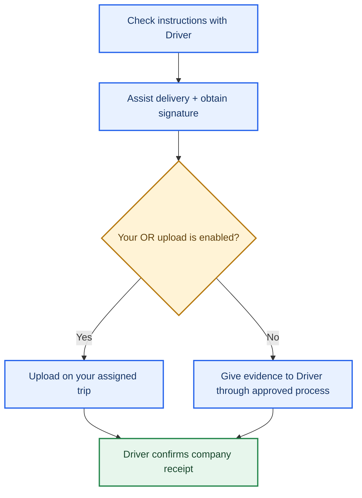

# Helper

[All roles](README.md) · [Feature guide](../user-guide.md)

> **Your job:** Support the delivery and signature. Upload only when enabled.

**Helper workflow. Support the delivery and signature. Upload only when enabled.**

## What can I use?

| Screen / area       | Your access                                       |
| ------------------- | ------------------------------------------------- |
| My trips            | Your assignments if you have a login              |
| OR upload / viewing | Only if the Helper grant is enabled               |
| Crew work           | A recorded Helper can be assigned without a login |

## Quick checklist

- [ ] **Before departure:** Check the assignment with Driver/Dispatcher.
- [ ] **At delivery:** Assist hauling and signature collection.
- [ ] **Upload unavailable:** Pass evidence to Driver; do not bypass permissions.

> **Remember:** Do not borrow the Driver login. Only the Driver records progress and confirms receipt.

## When you need the details

<strong>Responsibility and access</strong>

Assist with hauling and obtaining the delivery signature. An employee record is required for assignment; a sign-in account is needed only if you personally use the app. With an account, see your own assignments. Uploading/viewing OR files depends on the administrator-enabled Helper grant; it is off by default.

<strong>On a trip</strong>

1. Check **My trips** if you have a login, or obtain instructions from the assigned Driver/Dispatcher.
2. Confirm pickup/destination and assist the assigned crew. Report assignment mistakes before departure.
3. Help obtain the receiving party's signature. Driver records delivery.
4. If enabled, follow [OR upload](../user-guide.md#9-signed-or-stamped-copy-and-completion) on your assigned trip: JPEG/PNG ≤5 MB; wait for upload success. You may add an optional stamped copy in permitted states.
5. If upload controls are absent, pass the evidence to the Driver through BM's approved process. Do not borrow their login.

The Driver alone accepts, departs, records delivery and confirms company receipt. Uploading a document as Helper does not complete a trip. Tell Driver/Dispatcher if evidence is wrong or upload failed. Owner handles mistaken confirmations.

<strong>Future personal records</strong>

Own payroll statements and personal advance requests are planned. One-helper share starts at 4% of earnings base; two-helper shares start at 3% each, under the versioned working policy. These are not current calculated balances or guaranteed preview amounts. Your personal deductions/repayments must be separately documented; operating expenses are not deducted twice. See [financial policies](../../decisions/financial-policies.md).

[Troubleshooting](../user-guide.md#11-troubleshooting-and-interrupted-operations) · [Financial policies](../../decisions/financial-policies.md)
