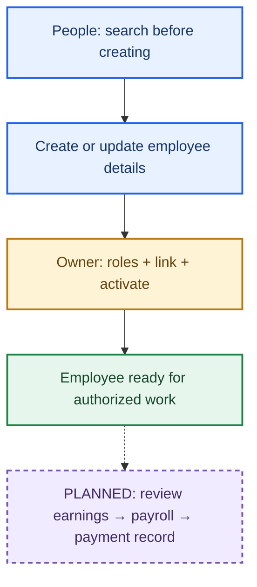

# HR and Payroll

[All roles](README.md) · [Feature guide](../user-guide.md)

> **Your job:** Maintain employee records now; prepare for the planned payroll workflow.

**HR and Payroll workflow. Maintain employee records now; prepare for the planned payroll workflow.**

## What can I use?

| Screen / area      | Your access                             |
| ------------------ | --------------------------------------- |
| People             | Create/edit employee records            |
| Driver licenses    | Read details; Fleet/Owner makes changes |
| Payroll / Advances | Preview screens — no real processing    |

## Quick checklist

- [ ] **New employee:** Create once → ask Owner to authorize and activate.
- [ ] **License issue:** Refer correction to Fleet.
- [ ] **Leaving employee:** Notify Owner and Dispatcher promptly.

> **Remember:** Owner activates accounts. Payroll previews cannot release money or deduct wages.

> **Finance status:** policies are defined; financial services are not implemented. Preview values are not real pay, debt or invoices.

## When you need the details

<strong>Current responsibility and access</strong>

Create/edit employee records and read Driver license details. Owner activates/deactivates, assigns roles and links sign-in accounts; Fleet/Owner changes license records. HR has no order/dispatch/billing/audit authority. Attendance, leave, regular salaries, benefits and statutory deductions are outside the defined implementation.

<strong>Maintain employee records</strong>

1. Follow [People](../user-guide.md#2-people-and-accounts): search before creating; enter name/email/phone and save.
2. Ask Owner to assign roles, link sign-in where needed and activate the new record. An inactive employee cannot be assigned to trips.
3. Edit contact details when authorized; keep identities separate and do not create duplicates to change roles.
4. Review a Driver's **License status/details** where available; refer corrections to Fleet.
5. Notify Owner promptly when access should end and Dispatcher when assigned work must be changed.

<strong>Payroll procedure — planned, not available in preview</strong>

1. Select the semi-monthly period and identify completed trips with finalized charges and reviewed expenses/explicit zero.
2. Leave incomplete finance **Pending Calculation**; this does not block operational completion.
3. Review one original earning per employee/trip, saved crew/rate version and decimal rounding. Route negative-base or disputed entries to Owner.
4. Prepare permitted employee deductions/adjustments for independent Owner approval; do not deduct fuel/toll twice.
5. Preview agreed advance installments. Draft payroll does not reduce debt. Finalization posts approved deductions/repayments once and holds insufficient-pay cases under the working arrangement.
6. Provide the detailed statement, record actual payment releases/reference, and reconcile unpaid balances. A calculation is not a money transfer.

<strong>Advances — planned</strong>

Prepare requests on behalf of employees if needed; obtain independent Owner approval. Record actual release and acknowledgment, not merely approval. Apply the agreed fixed installment at payroll finalization; partial release/repayment and reversal update balance precisely. Keep trip operating advances separate from personal debt.

These steps follow [financial policies](../../decisions/financial-policies.md). Financial persistence, approvals and statements still need implementation and D16 review before real payroll use. Current sample screens cannot process pay.

[Troubleshooting](../user-guide.md#11-troubleshooting-and-interrupted-operations) · [Financial policies](../../decisions/financial-policies.md)
