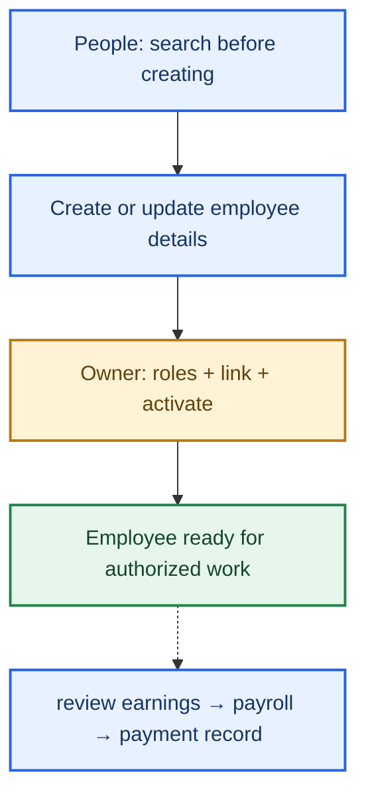

# HR and Payroll

[All roles](README.md) · [Feature guide](../user-guide.md)

> **Your job:** Maintain employee records, prepare payroll, and record actual releases and payments.

**HR and Payroll workflow. Maintain employee records, prepare payroll, and record actual releases and payments.**

## What can I use?

| Screen / area      | Your access                              |
| ------------------ | ---------------------------------------- |
| People             | Create/edit employee records             |
| Driver licenses    | Read details; Fleet/Owner makes changes  |
| Payroll / Advances | Persistent payroll and advance workflows |

## Quick checklist

- [ ] **New employee:** Create once → ask Owner to authorize and activate.
- [ ] **License issue:** Refer correction to Fleet.
- [ ] **Leaving employee:** Notify Owner and Dispatcher promptly.

> **Remember:** Owner activates accounts and independently approves designated financial proposals. Draft payroll does not post repayments. Recording a payment does not transfer money; personal deductions remain disabled pending D16 review.

> **Finance status:** persistent modules are available on this branch. [Current procedures and role boundaries](../sprint-5-6.md). DEMO records are fictional; real financial use remains gated.

## When you need the details

<strong>Current responsibility and access</strong>

Create/edit employee records and read Driver license details. Owner activates/deactivates, assigns roles and links sign-in accounts; Fleet/Owner changes license records. HR has no order/dispatch/billing/audit authority. Attendance, leave, regular salaries, benefits and statutory deductions are outside the defined implementation.

<strong>Maintain employee records</strong>

1. Follow [People](../user-guide.md#2-people-and-accounts): search before creating; enter name/email/phone and save.
2. Ask Owner to assign roles, link sign-in where needed and activate the new record. An inactive employee cannot be assigned to trips.
3. Edit contact details when authorized; keep identities separate and do not create duplicates to change roles.
4. Review a Driver's **License status/details** where available; refer corrections to Fleet.
5. Notify Owner promptly when access should end and Dispatcher when assigned work must be changed.

<strong>Payroll procedure</strong>

1. Open **Payroll → Prepare payroll period**, use a 1st/16th start, and identify completed trips with final charges and reviewed expenses/zero. The earning calculation runs when prerequisites arrive; **Calculate ready trip earnings** retries pending work.
2. Leave incomplete finance **Pending Calculation**; this does not block operational completion.
3. Review one original earning per employee/trip, saved crew/rate version and decimal rounding. Route negative-base or disputed entries to Owner.
4. Prepare permitted employee deductions/adjustments for independent Owner approval; do not deduct fuel/toll twice.
5. Preview agreed advance installments. Draft payroll does not reduce debt. Finalization posts approved deductions/repayments once and holds insufficient-pay cases under the working arrangement.
6. After the period ends, select **Finalize reviewed payroll**. Use **Record actual payroll payment** for actual amount/date/method/reference and inspect unpaid balances. A calculation/record is not a money transfer; payment is blocked for held or overpaid statements.

<strong>Advances</strong>

Use **Cash advances → Request personal advance** on behalf of an employee if needed; obtain independent Owner approval. Named HR approval requires a valid delegation, and a different HR person must release an advance that HR approved. Record actual release and acknowledgment, not merely approval. Apply the agreed fixed installment at payroll finalization; partial release/repayment and reversal update balance precisely. Keep trip operating advances separate from personal debt.

See the [exact financial screen procedures](../user-guide.md#10-dashboard-audit-permissions-and-finance), including period close, disabled deductions, held statements and unsupported paid-record correction limits.

These steps follow [financial policies](../../decisions/financial-policies.md). Persistence, approvals and statements are implemented. D16 review remains required before real payroll use; DEMO records do not represent actual pay.

[Troubleshooting](../user-guide.md#11-troubleshooting-and-interrupted-operations) · [Financial policies](../../decisions/financial-policies.md)
