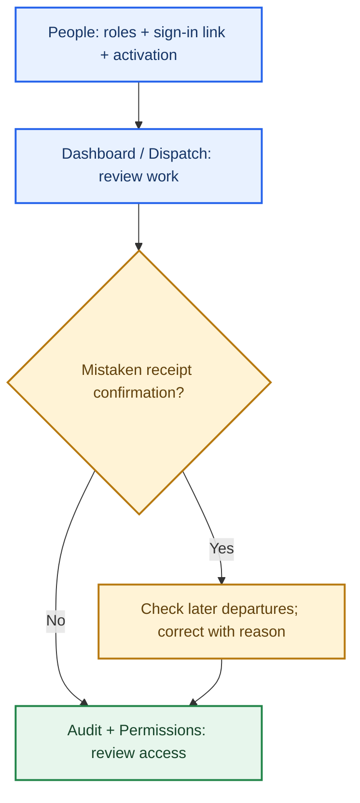

# Owner / Manager

[All roles](README.md) · [Feature guide](../user-guide.md)

> **Your job:** Authorize people. Oversee operations. Resolve exceptions.

**Owner / Manager workflow. Authorize people. Oversee operations. Resolve exceptions.**

## What can I use?

| Screen / area       | Your access                                             |
| ------------------- | ------------------------------------------------------- |
| People              | Assign roles, link identity, activate/deactivate        |
| Dispatch            | Monitor, clear, replace; correct receipts where allowed |
| Audit / Permissions | Read history and review grants                          |

## Quick checklist

- [ ] **New employee:** Review → roles → link identity if needed → activate.
- [ ] **Wrong receipt:** Check facts → record reason → reopen only if allowed.
- [ ] **Quarterly review:** Review access → disable unused accounts.

> **Remember:** Order entry needs Dispatcher duties. The assigned Driver still confirms receipt.

> **Finance status:** policies are defined; financial services are not implemented. Preview values are not real pay, debt or invoices.

## When you need the details

<strong>Responsibility and access</strong>

Oversee operations, activate employees, manage roles/sign-in links, review audit and correct mistaken company-receipt confirmations. Maintain trucks/licenses and perform dispatch where authorized. Owner alone has read-only orders/clients: add Dispatcher duties to the same account when the Owner also records requests. Owner never confirms an OR instead of the assigned Driver.

<strong>Set up an employee</strong>

1. Follow [People and accounts](../user-guide.md#2-people-and-accounts) to create/review the record.
2. Open **Roles**, select the person's actual duties and save. Preserve separation of duties; exceptional forbidden combinations require a documented reason.
3. Link the correct Clerk identity for sign-in users. Drivers require an account; non-operating helpers do not.
4. Select **Activate**, then have the employee sign in and inspect **My account**. Have Fleet record the Driver's license before dispatch.
5. On termination/suspension, select **Deactivate** and tell Dispatcher to resolve assigned work. Do not delete history or reuse a person's identity.

<strong>Daily operations</strong>

1. Open **Dashboard/Dispatch** and review ongoing trips, resources and ORs awaiting receipt.
2. Ask Dispatcher/Driver to resolve outstanding evidence; do not override the OR departure restriction.
3. For a reported mistaken confirmation, open the completed trip's **Correct confirmation** action, verify facts and record the reason. The backend prevents reopening after a later resource trip departed. Otherwise the Driver reconfirms after actual receipt; later cleared trips may need re-clearance.
4. Review **Audit log** for account changes, replacements, confirmations and corrections. Investigate unusual actions using record/trace references.
5. Use **Permissions** to review grants; use **People → Roles** to change assignments. Reassess access quarterly and disable unused accounts.

Expected outcome: each employee acts through their own authorized identity; operational history remains traceable. For a blocked correction, retain the evidence and request a designed adjustment process rather than changing database values manually.

<strong>Financial responsibilities — policies defined, screens are previews</strong>

Under [financial policies](../../decisions/financial-policies.md), configure future-dated earnings percentages; independently approve expenses where permitted, deductions/adjustments and personal advances; review rate variances/negative bases; approve Accounting invoice-void requests. Never approve your own entry or pay. HR records releases/payroll payments; Accounting records collections. If no independent approver exists, leave the item pending. These actions require future implementation and cannot be completed through the preview screens.

[Troubleshooting](../user-guide.md#11-troubleshooting-and-interrupted-operations) · [Financial policies](../../decisions/financial-policies.md)
