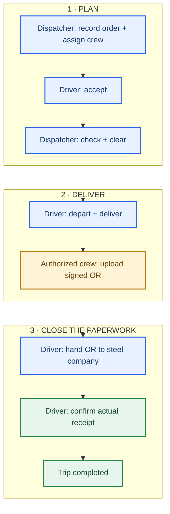
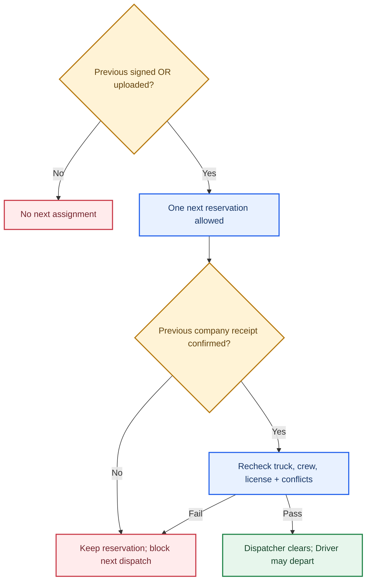
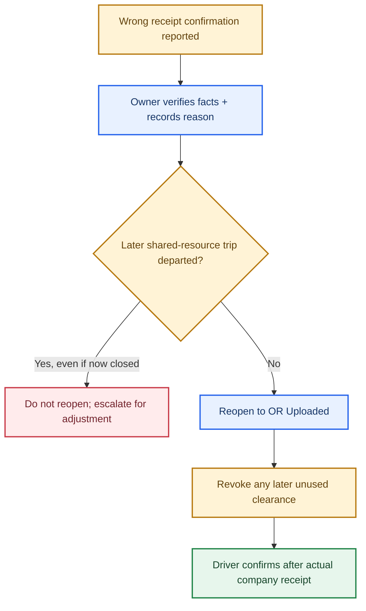
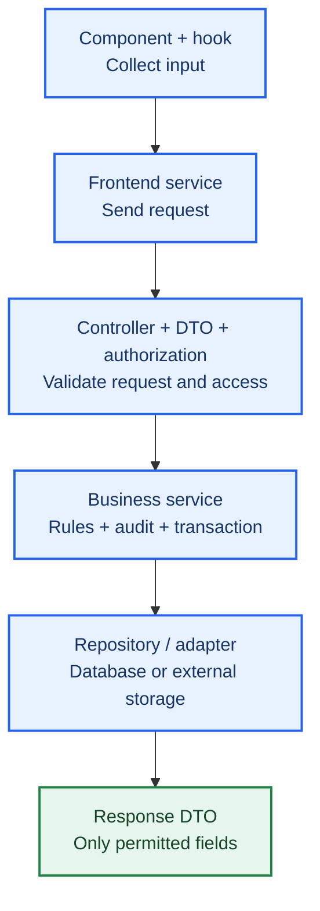
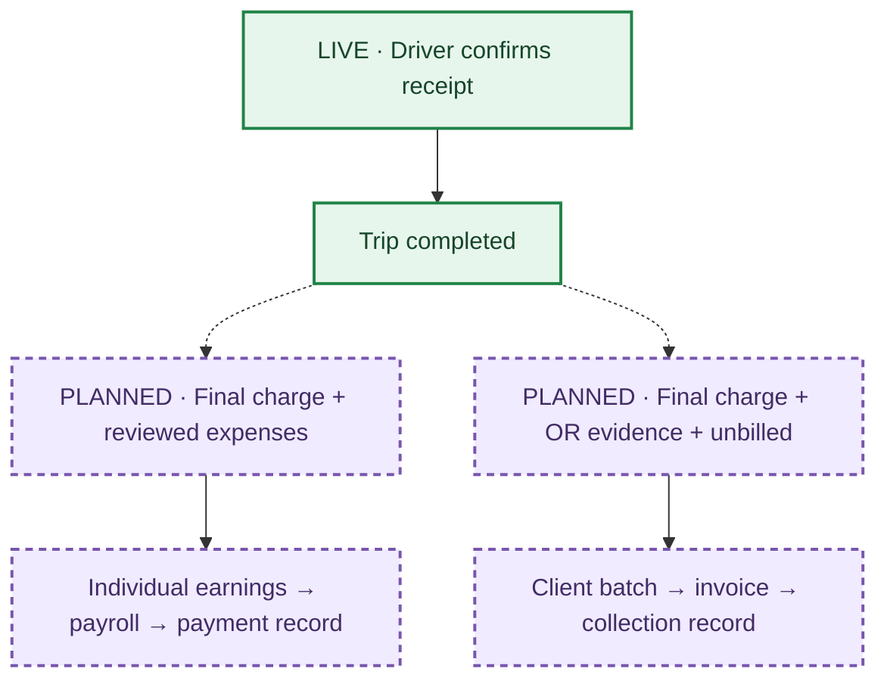

# Service workflow and business rules

[Index](../README.md) · [User guide](user-guide.md) · [Financial policies](../decisions/financial-policies.md)

Source: consolidated specification §§3–10 and §15. Dispatcher-approved completion and a combined completion/payroll/invoice transaction are superseded.

> **Three separate results:** trip completed, earnings ready, client bill ready. One status must never stand in for all three.

## 1. Operational sequence

**Order to trip completion by role.**

<strong>Rules, handoffs and exceptions</strong>

| Step              | Actor/input                                       | Outcome/handoff                                           | Checks                                                                                                                  |
| ----------------- | ------------------------------------------------- | --------------------------------------------------------- | ----------------------------------------------------------------------------------------------------------------------- |
| Prepare resources | Owner, HR, Fleet; employees/roles/licenses/trucks | Eligible resources for Dispatcher                         | Active crew, Driver account, capacity and license                                                                       |
| Record request    | Dispatcher; client, locations, date, tons         | Pending order                                             | Valid client/fields; current order has no commercial rate                                                               |
| Assign            | Dispatcher/Owner; order, truck, load and crew     | Scheduled trip; derived order/truck state                 | Capacity, remaining load, condition, active distinct crew, roles, license valid for later of today/trip date, conflicts |
| Accept            | Assigned Driver                                   | Accepted                                                  | Driver identity/ownership, Scheduled                                                                                    |
| Clear             | Dispatcher/Owner                                  | Cleared for dispatch                                      | Recheck current truck capacity/condition, crew status/roles, license and resource conflicts                             |
| Depart            | Assigned Driver                                   | In transit; order/truck updated                           | Cleared plus current checks repeated                                                                                    |
| Deliver           | Assigned Driver; physical signature               | Delivered — OR Pending                                    | In-transit state, ownership                                                                                             |
| Upload            | Driver or enabled assigned Helper; signed image   | OR Uploaded; advance reservation eligible                 | Delivered, correct role/ownership, JPEG/PNG content, ≤5 MB, storage succeeds                                            |
| External handover | Driver gives OR to company                        | Physical receipt outside app                              | Upload alone is not receipt; no steel-company system integration                                                        |
| Confirm           | Assigned Driver; actual receipt time              | Completed; restriction removed; next reservation retained | Stored signed OR, valid time, idempotency key; no Dispatcher approval                                                   |
| Finance           | Authorized finance staff                          | Independent earnings/billing readiness                    | Planned services under [working policies](../decisions/financial-policies.md)                                           |

## 2. Reservation and clearance

**Reservation and next-dispatch decision tree.**

<strong>Rules, handoffs and exceptions</strong>

| Prior trip stage                        | Next assignment?             | Next clearance/departure?  |
| --------------------------------------- | ---------------------------- | -------------------------- |
| Before signed OR upload                 | No                           | No                         |
| Signed OR uploaded, receipt unconfirmed | Yes, one advance reservation | No                         |
| Receipt confirmed                       | Yes absent other conflicts   | Yes if current checks pass |

Check the truck, driver and every helper. Errors identify blocking trips. Required message: **“Dispatch blocked: The previous trip's OR has not yet been marked as received by the steel company.”** A truck change must not bypass it. Completing the prior trip preserves the next reservation and does not make a reserved resource freely available.

## 3. Exceptions

**Owner receipt-correction decision tree.**

<strong>Rules, handoffs and exceptions</strong>

| Event                               | Behavior                                                                                            | Handoff                                                      |
| ----------------------------------- | --------------------------------------------------------------------------------------------------- | ------------------------------------------------------------ |
| Driver changes before departure     | Reset to Scheduled                                                                                  | New Driver accepts                                           |
| Helpers change after clearance      | Reset to Accepted                                                                                   | Dispatcher clears again                                      |
| Crew changes after departure        | Rejected (`CREW_LOCKED`) under current D2 default                                                   | Escalate; no historical crew/pay rewrite                     |
| Truck replacement                   | Before departure/in transit; revalidate replacement; retain same trip and reason/time/actor/history | Dispatcher → Driver/Fleet                                    |
| Original truck broken               | Mark maintenance; completion does not release it                                                    | Fleet explicitly completes maintenance                       |
| Cancel                              | Before departure only; reason; free allocated load                                                  | Dispatcher/Owner                                             |
| Fail                                | In Transit or Delivered — OR Pending only; reason; free allocated load                              | Dispatcher/Owner; failed-work pay remains D3                 |
| Wrong receipt confirmation          | Owner gives reason; reopen to OR Uploaded if no later resource trip departed                        | Driver reconfirms with new operation key                     |
| Later resource trip departed        | Correction rejected even if later trip is now Completed/Failed                                      | Separate adjustment process required; do not rewrite history |
| Later trip cleared but not departed | Correction revokes clearance to Accepted                                                            | Re-clear after receipt reconfirmation                        |
| Stamped copy absent                 | Completion allowed; audit records its presence/absence                                              | Manual spot-check; dedicated report planned                  |
| Upload failure                      | Completion unavailable until signed OR stored                                                       | Correct file/retry; escalate storage failure                 |

## 4. Transactions and retries

**A request crosses validation, service and repository boundaries.**

<strong>Rules, handoffs and exceptions</strong>

Controllers authenticate/validate; services check role, object and state rules and coordinate repositories. Mutations commit operational changes and audit together; repositories flush without committing independently.

Images are checked and re-encoded to remove metadata; storage paths are server-generated. Upload stores the object before document metadata commits, attempting cleanup after a failed commit. Signed links are issued after access checks. Live Supabase verification remains outstanding.

Receipt confirmation requires an `Idempotency-Key`. Repeating the operation does not duplicate completion; the UI retains its key while a submission fails. After a timeout, reload before starting a different business action. After Owner correction, use a new confirmation operation.

Completion updates trip/receipt, derived order/truck state and audit. It does not wait for expenses, payroll, invoices or client collection. Future earnings generation is separate and idempotent with one original employee/trip entry. No outbox runs without a defined recipient.

## 5. Financial handoff — planned

**Operations complete before independent planned payroll and billing branches.**

<strong>Rules, handoffs and exceptions</strong>

Completed trip → final charge + submitted expenses → independent approval or reviewed zero → calculate individual earnings → finalize period → apply approved personal deductions/repayments → record actual employee payments.

Separately: completed trip + finalized charge + signed OR + company receipt + unbilled charge → select one-client billing batch → issue invoice → record collections. Expense review does not block operations. Partial orders and older trips can be billed. See [financial policies](../decisions/financial-policies.md) for holds, cutoffs, reversals and approval duties.

## 6. Requirement traceability

<strong>Requirement-to-code reference</strong>

Paths are relative to `src/backend/src/`; test names are in `src/backend/tests/`.

| Specification       | Source                                                                             | Verification / gap                                                                       |
| ------------------- | ---------------------------------------------------------------------------------- | ---------------------------------------------------------------------------------------- |
| §3 access/identity  | Authentication, authorization and employee services; `Data/permission_matrix.json` | `test_authentication`, `test_permission_matrix`, `test_employees`                        |
| §§4–5 dispatch      | `Service/trip_service.py`, `Entity/dispatch.py`, `Repository/trip_repository.py`   | `test_dispatch_assignment`, `test_dispatch_flow`, `test_dispatch_revalidation`           |
| §6 OR/completion    | `Service/or_service.py`, storage/imaging adapters, state synchronizer              | `test_or_documents`, `test_or_completion`, `test_storage_adapters`; live storage pending |
| §§7–8 finance       | Preview UI and policy document                                                     | Entities/services/migrations/APIs/tests still required                                   |
| §9 billing          | Billing preview and policy document                                                | Persistent implementation still required                                                 |
| §10 records/reports | Audit repository/controller and frontend dashboard/audit                           | Live operational views; financial/exception reports planned                              |
| §§11–12 platform    | DTOs, JWT/webhook checks, upload limits, migrations, CI                            | Postgres hardening; staging/backup/mobile/outage drills pending                          |

A seeded capability or preview page does not mean its financial service exists.

