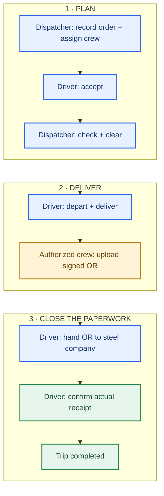
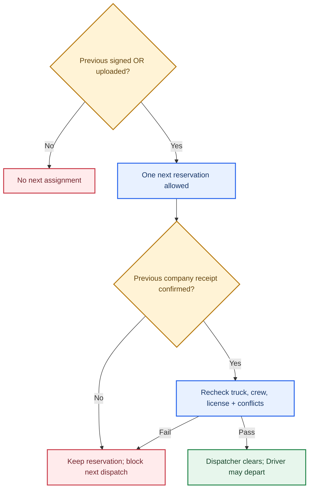

# User feature guide

**Want to practice?** Start with [the guided delivery exercise](delivery-walkthrough.md).

[Index](../README.md) · [Choose your role](roles/README.md) · [Terms and statuses](../taxonomy.md)

These procedures describe the current operational screens. **Soon / Design preview** pages contain invented examples; they do not save expenses, wages, advances, invoices or payments. Use the [financial policies](../decisions/financial-policies.md) as future process instructions only.

## Find your task quickly

**The three phases of a delivery: plan, deliver and close the paperwork.**

| Prepare                                                                                  | Deliver                                                                            | Resolve an issue                                                  |
| ---------------------------------------------------------------------------------------- | ---------------------------------------------------------------------------------- | ----------------------------------------------------------------- |
| [People](#2-people-and-accounts) · [Licenses](#3-driver-licenses)                        | [Dispatch](#7-dispatch-and-assignment) · [My trips](#8-my-trips-driver-and-helper) | [Troubleshooting](#11-troubleshooting-and-interrupted-operations) |
| [Clients](#4-clients) · [Orders](#5-delivery-orders) · [Fleet](#6-fleet-and-maintenance) | [OR and completion](#9-signed-or-stamped-copy-and-completion)                      | [Owner corrections](service-workflow.md#3-exceptions)             |

## 1. Sign in and understand your access

**Open app → sign in → check My account.** Owner must link and activate your employee first.

<strong>Full procedure and exception rules</strong>

Prerequisite: the Owner has linked your sign-in account to an active employee and assigned appropriate roles.

1. Open the application URL supplied by your administrator. Local use is normally `http://localhost:5173`; a shared development URL works only while its host is running.
2. Sign in with your assigned email and application password, or an enabled sign-in method. Enter the actual email verification code when requested. A normal Gmail alias is not a test-code account.
3. Open **My account** to check your name, roles and access levels. Tell the Owner if incorrect; changing Clerk metadata does not change your system permissions.
4. Use the sidebar; on small screens open the menu or bottom navigation. Only permitted pages appear. Sun/moon switches appearance, not access.
5. Sign out through the account control when finished, especially on a shared device. Do not share accounts or passwords.

If sign-in succeeds but the workspace is blocked, ask the Owner to check the Clerk link and employee activation. Repeatedly creating new sign-ins will not grant a role. If another person's information appears, stop using that session and report it to the administrator.

## 2. People and accounts

**Create → assign roles → link sign-in → activate.** HR can create/edit; Owner controls access.

<strong>Full procedure and exception rules</strong>

**Who:** Owner/HR create/edit. Owner alone manages roles, identity linking, activation/deactivation. Fleet/Dispatcher see limited employee data for license tasks.

1. Open **People → Add employee**. Enter name, email and optional phone; save.
2. New records are inactive. The Owner opens the person's action menu → **Roles**, selects duties and saves. Forbidden combinations require an Owner exception reason; use a genuine documented reason, not placeholder text.
3. For people who will sign in, an administrator creates/invites the identity in Clerk using the team's sign-in setup. The Owner uses **Link sign-in account** and the correct Clerk user ID. This links an existing identity; it does not create a password in the BM database.
4. Owner selects **Activate** when the person is authorized. Drivers need a linked account; helpers may remain without a sign-in account if they perform no app actions.
5. To edit contact details, use **Edit details**. To remove access, Owner selects **Deactivate**. History is preserved; discuss any outstanding assigned trips with Dispatcher.

Search by name (and email/role when your access exposes those fields), or use Active/Inactive tabs. Limited viewers see only names/status; hidden email, role and account fields are deliberately omitted. Do not infer “no account” from an omitted field.

## 3. Driver licenses

**People → Driver license → save number and expiry.** Fleet/Owner write; other grants are read-only or limited.

<strong>Full procedure and exception rules</strong>

**Who:** Fleet/Owner enter and update; HR reads details; Dispatcher sees validity only. Backend also supports a Driver reading their own license; no separate Driver license editor is provided.

1. Open **People**, find the driver by name and open **Driver license** (or **License status** for read-only access).
2. Review existing validity. Fleet/Owner enters the license number and expiry date and selects **Save license**.
3. Confirm the saved expiry and status. Updating a license does not automatically clear a trip; return to Dispatcher for eligibility recheck.

Limited employee records do not include roles, so license actions can appear beside a non-driver. Saving is still rejected unless the person has the Driver role. “No license on record” means a license must be recorded for a driver before assignment. A license must remain valid for the scheduled trip and actual dispatch date.

## 4. Clients

**Search before adding.** Dispatcher writes; Owner/Accounting read. Rates are not stored here.

<strong>Full procedure and exception rules</strong>

**Who:** Dispatcher writes; Owner/Accounting read.

1. Open **Clients**, search for an existing record before adding another.
2. Select **New client**, enter the organization name and available contact details; save.
3. Use the row action to edit incorrect contact details. Confirm the correct client before creating an order.

Expected result: the client is available in the order form. This page currently stores operational contact information, not client hauling rates.

Use the client action menu to deactivate an unused client or reactivate one when appropriate. Existing history stays recorded; verify the correct active client before new orders.

## 5. Delivery orders

**New order → client, locations, date and tons → save.** Only Pending orders can be edited/cancelled.

<strong>Full procedure and exception rules</strong>

**Who:** Dispatcher writes; Owner/Accounting read. An Owner who also performs order entry needs the Dispatcher role; Owner alone has VIEW here.

1. Obtain the steel company's delivery instructions outside the app.
2. Open **Delivery orders → New order**. Select client, enter pickup and delivery locations, scheduled date, total weight in metric tons, reference and notes where applicable.
3. Check the load and save. The order starts Pending; assignment and trip progress derive its status.
4. Correct permitted fields through **Edit**. Only Pending orders can be edited.
5. If the request is withdrawn, use **Cancel** with a reason. Only Pending orders can be cancelled; coordinate existing trip commitments first.

Expected result: Dispatcher can select the order in **Dispatch → Assign trip**. A 40-ton order might need two trips on 25-ton trucks; each trip must respect capacity and remaining unassigned load. Do not lower the order weight below existing assigned load.

## 6. Fleet and maintenance

**Register → maintain → explicitly return to service.** Coordinate assigned-truck breakdowns with Dispatcher.

<strong>Full procedure and exception rules</strong>

**Who:** Fleet/Owner write; Dispatcher reads.

1. Open **Fleet → Register truck**. Enter plate, description and capacity in metric tons; save.
2. Use the truck action menu to edit its record, inspect maintenance or start maintenance with a reason.
3. A truck already assigned/in transit cannot be retired or placed into ordinary maintenance directly. Coordinate **Replace truck** with Dispatcher and mark the original truck as needing maintenance.
4. After the real repair, choose **Complete maintenance**. Confirm its availability before recommending assignment.

Expected result: maintenance trucks cannot be assigned. Completing a delivery does not repair a truck. If capacity is corrected after assignment, clearance/departure recheck it and may reject the current load.

To retire an unused truck, open **Edit truck**, switch off **Active in the fleet**, and save. Assigned/in-transit trucks cannot be retired. Keep the record for history; use the same field to reactivate an eligible vehicle when appropriate.

## 7. Dispatch and assignment

**Assign → Driver accepts → Dispatcher clears.** Check every truck/crew member and prior OR restriction.

**A signed OR permits a reservation; receipt confirmation and eligibility permit dispatch.**

<strong>Full procedure and exception rules</strong>

**Who:** Dispatcher/Owner. Driver actions occur separately under My trips.

1. Open **Dispatch → Assign trip**. Select the order, truck, trip load, one Driver and one or two distinct Helpers.
2. Unavailable choices show a reason. Check capacity, license and crew; save the assignment.
3. Ask the assigned Driver to select **Accept trip**. Scheduled is not permission to depart.
4. When Accepted, select **Clear for dispatch**. If rejected, follow the returned reason and blocking trip ID. For an outstanding OR, the prior assigned Driver must record actual company receipt.
5. The Driver then selects **Record departure**. Eligibility is checked again, so a previously cleared trip can still be blocked by a subsequent change.
6. Follow the board through delivery, paperwork and closed stages. Completion comes from the Driver's receipt confirmation.

The board shows only a limited set of recent closed cards, not a full historical report. Data loads on page entry and after actions; refresh/reopen to observe changes made by another employee. There is no live GPS tracking.

### Crew, truck and exception actions

- **Change crew:** before departure only. New Driver must accept again; changed helpers invalidate existing clearance.
- **Replace truck:** before departure or in transit. Select a suitable replacement, give a reason, and tick original truck needs maintenance where true. The same trip continues; no new charge/pay is created by replacement.
- **Cancel:** before departure; mandatory reason.
- **Mark as failed:** after departure in eligible states; mandatory reason. Earnings for failed/partial work are not implemented.
- **Correct confirmation:** Owner only, completed trip, mandatory reason. Rejected if a later trip sharing a resource already departed, even if now closed. A later clearance can be revoked and must be obtained again.

## 8. My trips: Driver and Helper

**Driver:** accept, depart, deliver. **Helper:** assist and view own assignments; no Driver actions.

<strong>Full procedure and exception rules</strong>

1. Open **My trips**, check date, load, pickup and destination against instructions. Only assigned trips are listed.
2. Driver selects **Accept trip**, waits for Dispatcher clearance, then **Record departure** at departure.
3. At delivery, obtain the receiving party's signature and select **Record delivery**.
4. Follow the OR procedure below. Helper does not accept, depart, deliver or confirm on behalf of the Driver.

If a trip is missing, refresh and contact Dispatcher. Do not use another driver's login. If assigned information is wrong, have Dispatcher correct it before departure.

## 9. Signed OR, stamped copy and completion

**Signed OR upload → physical company handover → Driver confirms receipt.** JPEG/PNG, at most 5 MB; stamped copy is optional.

<strong>Full procedure and exception rules</strong>

**Who:** assigned Driver; assigned Helper only if explicitly enabled for upload. Only assigned Driver confirms receipt.

1. After recording delivery, open **Signed OR** on the trip card.
2. Select a legible **JPEG or PNG no larger than 5 MB** and upload. A PDF/HEIC or renamed non-image is rejected; export a genuine JPEG/PNG if needed.
3. Wait for success and **OR Uploaded** status. If the wrong image was selected, replace the signed OR before confirmation. Do not assume upload succeeded after a timeout—reload and inspect.
4. Physically submit the OR to the steel company for receipt. The app does not perform this handover.
5. After actual receipt, Driver opens **Confirm receipt**, checks the date/time and submits. Time must not precede recorded delivery or be in the future (subject to small server clock tolerance). Use the real receipt time, not a value chosen to unblock dispatch.
6. Verify **Completed**. The prior OR restriction is removed; any already reserved next trip stays reserved.
7. Upload a **Stamped copy (optional)** when available. It can be added after completion. It supports checking but is not required for completion.

Document buttons request temporary signed links. Reopen from the app if a link expires; never make the bucket public to solve access. Helpers without the enabled grant see no upload or document-opening controls. If confirmation was mistaken, notify Owner; Dispatcher cannot approve or undo it.

## 10. Dashboard, audit, permissions and preview finance

**Dashboard:** operations. **Audit/Permissions:** Owner review. **Finance:** preview examples only.

<strong>Full procedure and exception rules</strong>

- **Dashboard:** Owner/Dispatcher review current trips and resource summaries; open the relevant operational screen to act.
- **Audit log:** Owner searches actions/entity/trace, and loads older entries. Records are read-only. Use the trace ID when reporting a failed request; omit private data from the report.
- **Permissions:** Owner inspects the stored role-capability table. This is a viewer, not a permission editor; role assignment happens in People. Conditional helper grants still depend on the configured flag.
- **Trip expenses, Payroll, Cash advances, Billing, Reports:** current preview screens show intended layouts only. Do not use their amounts as employee balances, issue them to clients or treat an example button as a saved transaction. Role manuals explain the planned responsibilities under the financial working policies.

## 11. Troubleshooting and interrupted operations

**Read the error, refresh the record, contact the responsible role.** Avoid duplicate submissions after timeouts.

| Symptom                              | Action                                                                                                     |
| ------------------------------------ | ---------------------------------------------------------------------------------------------------------- |
| Cannot open app                      | Ask administrator to check src/frontend/API/database/tunnel; local URLs refer to your own computer         |
| Sign-in works, access denied         | Owner checks active local employee, identity link and role; do not create duplicate identities             |
| Button absent                        | Check My account capabilities and trip state; permissions may intentionally hide it                        |
| `DISPATCH_BLOCKED`                   | Identify the blocking trip and arrange actual OR handover/Driver confirmation                              |
| License/crew/capacity rejection      | Fleet/Owner correct license/capacity, Owner resolves active status, Dispatcher changes eligible crew/truck |
| Upload rejected                      | Check real file type, size, delivery status and assignment; retry only after resolving issue               |
| Signed link expired                  | Open document again within app                                                                             |
| Not found on another person's record | Access may be deliberately concealed; ask authorized staff rather than guessing IDs                        |
| Save/confirmation times out          | Reload current record before retrying; do not create a duplicate trip/order/payment                        |
| Page shows old information           | Refresh or reopen; operational lists are not live push subscriptions                                       |

During an outage, Dispatcher records a paper log with order/trip reference, actor and actual event times. Follow BM's operational contingency decision; do not claim the application cleared a trip while unavailable. Once restored, authorized roles reconcile records and duplicates in order. There is no offline queue or proven recovery-time guarantee today.
