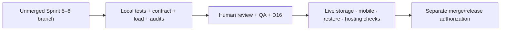
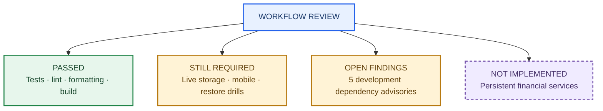

# Workflow/documentation change verification

Recorded implementation evidence: **18 November 2026**, branch `sprint-5-6-finance-and-reporting`, unmerged. Documentation reconciliation was performed afterward against the current source and retained evidence. This page separates current branch results from historical pre-Sprint-5 checks.

## Current Sprint 5–6 evidence

| Check                                  | Recorded result / scope                                                                                                                                                                               |
| -------------------------------------- | ----------------------------------------------------------------------------------------------------------------------------------------------------------------------------------------------------- |
| Complete PostgreSQL suite, Python 3.12 | 258 passed; one opt-in load skip. The separate load check passed.                                                                                                                                     |
| Complete SQLite suite, Python 3.14     | 251 passed, seven skipped; final focused contract/financial checks passed (five tests). These are the recorded runs, not a newly invented aggregate.                                                  |
| Frontend                               | 78 tests passed; lint, formatting and production build passed.                                                                                                                                        |
| Financial/report load                  | 30 trips, 20 users, 300 paced requests; zero failures, 30.27 s, achieved 9.91 requests/s, p95 102.45 ms. Local ASGI/PostgreSQL only.                                                                  |
| API contract                           | Running development contract matches the committed snapshot; documented RFC 9457 errors are normalized across Python versions.                                                                        |
| Permissions                            | Owner expenses Full; Owner billing View; no Owner payroll-payment grant. Inventory covers included routers and equals OpenAPI; Helper conditions and record/state/independence rules remain enforced. |
| Schema and development runtime         | Migrations through 0006; rebuilt/restarted Docker app containers; running Owner workspaces read successfully.                                                                                         |
| Dependency checks                      | Frontend production audit: zero vulnerabilities reported. Backend requirements audit: no known vulnerabilities reported. No refreshed full-development-audit claim is made.                           |
| Fictional presentation baseline        | Eight trips, nine earnings, four advances, two payrolls, three invoices; explicit repeatable seed preserves existing records and Clerk links. Later user actions can change these counts/states.      |

The detailed [Sprint 5–6 verification record](sprint-5-6-evidence/verification.md) and generator-owned [load measurement](sprint-5-6-evidence/load-postgres.json) retain the measurements. The documentation-only follow-up checks links/anchors, formatting, state/permission/route consistency and file coverage; it does **not** claim a fresh application, live-provider or browser test run. See the [documentation audit](documentation-audit.md).

## Remaining limits

Core finance and reports are implemented; they are no longer sample-only signed-in pages. The isolated `/preview.html` design harness still uses examples. `DEMO` records are fictional database content, not a production certification or actual transfers.

No fresh real Clerk/Supabase journey, phone installation, internet/TLS capacity check, restore drill or production deployment was performed during this documentation update. Real financial use still requires D16 and release approval. Paid-record refunds/reversals, trip-source corrections, unsupported receipt/category exceptions and other limits remain explicit in [policy coverage](../decisions/financial-policies.md#implementation-coverage-and-limits) and [QA acceptance](qa.md).

## Historical record before Sprint 5–6

The collapsed material below is retained as historical evidence. Its old test counts, unimplemented-finance statements, Docker limitations and development-advisory counts describe those earlier reviews, **not the current branch**. Links to current procedures may reflect the present handbook, while the recorded observations remain historical.

<strong>Historical workflow, layout and security reviews — superseded implementation status</strong>

Date: 18 November 2026. This records the current review, separately from older developer-guide test counts.

**Passed local checks, outstanding live checks, development advisories and unimplemented finance.**

| Recorded check                     | Result                                  |
| ---------------------------------- | --------------------------------------- |
| SQLite full suite                  | 214 passed; 6 PostgreSQL-only skips     |
| PostgreSQL full suite              | 217 passed before final additions       |
| PostgreSQL affected workflow rerun | 67 passed after final change            |
| Frontend                           | 72 tests + lint + format + build passed |
| Runtime dependency audit           | 0 findings                              |
| Development-tool audit             | 5 high-severity findings remain         |

These are the recorded implementation checks, not newly rerun application tests for a documentation-only edit.

## Final source-layout and security verification

After moving the applications to `src/backend/` and `src/frontend/`, development commands, CI paths, Compose contexts/watch mounts and Markdown references were updated. The root launcher adds `src/` to Python's module path while keeping root environment loading. Compose configuration validation passed; container builds/runtime are still a QA gate.

| Final developer-run check                                            | Result                                                                                                                                                              |
| -------------------------------------------------------------------- | ------------------------------------------------------------------------------------------------------------------------------------------------------------------- |
| Backend full suite / SQLite after security fixes                     | **221 passed**, 6 PostgreSQL-only skips                                                                                                                             |
| Backend full suite / PostgreSQL after security fixes                 | **227 passed**, dedicated scratch database removed after run                                                                                                        |
| Frontend after source move                                           | **72 passed**, production build and ESLint passed                                                                                                                   |
| Seven-role live browser check after source move and security restart | All seven expected `/me` roles, 47 permitted-page visits, no observed alerts/runtime errors; Owner-only endpoint denied the other six roles                         |
| Request-limit regressions                                            | Capacity saturation, concurrent admission, expiry, account isolation, forwarded-header spoofing at application level, upload throttling and response headers passed |
| Backend runtime dependency audit                                     | No known vulnerabilities reported by pip-audit                                                                                                                      |
| Frontend production dependency audit                                 | 0 vulnerabilities                                                                                                                                                   |
| Frontend full development dependency audit                           | 5 High findings remain; upstream advisory has no patched picomatch release listed                                                                                   |
| API contract                                                         | Existing OpenAPI snapshot still passes; no schema migration needed                                                                                                  |

These results support manual QA; they are not a claim that QA has signed off. See [QA acceptance](qa.md) for exact cases and the evidence/sign-off record. See [security hardening](../decisions/security-hardening.md) for bounded per-process limits and required proxy/shared-limiter hosting controls. The prior test totals below are retained as historical implementation evidence.

A separate loopback Uvicorn process with its own quota store was also checked over real TCP: changing `X-Forwarded-For` on three requests with an IP budget of two returned `401, 401, 429`. That process was terminated afterward; the running application?s user budgets were not consumed. This supports the shipped no-proxy-header setting, not a future hosting proxy certification.

## Fresh workflow test run — 18 November 2026

At the user's request, the application checks were rerun after the visual documentation update:

| Check                           | Fresh result                                                                                       |
| ------------------------------- | -------------------------------------------------------------------------------------------------- |
| Backend full suite / SQLite     | **214 passed**, 6 PostgreSQL-only skips                                                            |
| Backend full suite / PostgreSQL | **220 passed**, including migrations, permissions, dispatch, OR and receipt behavior               |
| Frontend                        | **72 passed** across 11 files                                                                      |
| Local HTTP checks               | Frontend `/`, API `/api/v1/health` and `/api/v1/docs` returned **200**                             |
| Live Clerk role checks          | All **7** existing development roles signed in and received `/me` **200** with their expected role |
| Live role navigation            | **47** role/page visits; no observed alert messages or browser runtime errors                      |
| Owner permission boundary       | `/permission-matrix` returned **200** for Owner and **403** for all six other roles                |

The PostgreSQL run created and removed its own scratch database; application operational tables were not reset. Automated workflow tests used test signing keys and fake object storage. They cover assignment, acceptance, clearance, departure, delivery, image validation, receipt completion, retries, corrections, resource restrictions and authorization. They do **not** certify a real Supabase upload.

Live browser checks used short-lived development Clerk sign-in tickets for existing accounts, then visited each permitted sidebar page. They verify session integration and navigation, rather than password/real-inbox delivery or a complete delivery entered through the live UI. No business records were created by those browser checks. The first restricted browser could not reach Clerk (`ERR_NETWORK_ACCESS_DENIED`); after network access was allowed, the sign-in form and authenticated role checks passed. No authentication checks were disabled.

The known Starlette TestClient deprecation and SQLite expression-index reflection warnings remain. Financial persistence is still unimplemented. Use [the guided delivery exercise](delivery-walkthrough.md) for manual acceptance testing, including a real private-storage upload.

## Visual handbook review

The readability update covers the original **17 Markdown guides**, plus a guided workflow exercise. Diagrams now live directly in fenced Mermaid blocks inside those Markdown pages. Separate exported images, diagram-source files and the image renderer were removed at the user's request. Short summaries, task tables and role checklists lead each guide; expandable sections preserve procedures, exceptions and implementation references.

| Documentation check | Result                                                                                                                    |
| ------------------- | ------------------------------------------------------------------------------------------------------------------------- |
| Diagram format      | Inline fenced Mermaid blocks; no image assets or external diagram files                                                   |
| Diagram validation  | All 38 inline Mermaid blocks parsed and rendered locally without writing image files                                      |
| Navigation          | Local file links and heading anchors checked, including the archive                                                       |
| Browser review      | Index, Driver and financial-policy pages rendered in a local Markdown preview; representative workflow diagrams inspected |
| Narrow screen       | Driver guide checked at 390 px; no horizontal page overflow; procedure disclosure opens                                   |
| Formatting          | Repository Prettier check passed                                                                                          |

These are documentation checks. The local preview is not a certification of every Markdown reader. Application suites were subsequently rerun at the user's request, as recorded above; the detailed implementation evidence below belongs to the preceding implementation review.

## Folder organization review

- Grouped feature UI under `src/frontend/src/components/<feature>/` and reusable UI under `src/shared/components/`.
- Moved page composition into `src/pages/` and all 11 frontend test files into `src/frontend/tests/unit/` and `tests/components/`; updated imports and the design-preview harness together.
- Removed the unused root npm manifest and lockfile. No application source imported their Supabase JavaScript dependency; storage remains handled by the Python backend adapter. Retired root-installed packages were moved to ignored workstation storage rather than deleted.
- Added a visible root/backend/frontend folder tree and placement table to [system structure](../architecture.md#repository-folder-architecture), and aligned the frontend README and developer structure reference.
- Verified after the moves: **72 frontend tests passed**, production build passed and ESLint passed. The local design-preview harness also rendered all seven role configurations across 47 page visits with zero browser runtime errors; this check used sample records, without signing into Clerk. Backend application files and schema were not moved in this cleanup; the earlier backend workflow results remain recorded above.

The repository root keeps only shared project configuration and coordination files. Framework entry points and app-level configuration remain in their expected application directories. Local credentials, database files and development-account records remain ignored.

## Changes under review

<strong>Evidence, scope and limitations</strong>

- Read the supplied 9 November consolidated Word specification and existing developer guide.
- Added module inventory, terminology, shared feature procedures, seven role manuals, service workflow, system structure and working financial policies D4–D10.
- Archived the original proposal and replaced the main README's superseded workflow with current behavior.
- Recheck truck/crew/license eligibility at clearance and departure.
- Require a linked Driver sign-in account before assignment; keep non-operating Helpers assignable without accounts.
- Keep receipt correction blocked after a later shared-resource trip closes; include truck replacement history in departure lookup.
- Derive crew upload/document controls from actual backend capability grants.
- Let limited employee viewers reach license actions without requiring full employee-management access or exposing hidden fields.
- Move asynchronous collection loading into shared services; standardize formatting and add a CI formatting check.

## Evidence

<strong>Evidence, scope and limitations</strong>

The six new dispatch eligibility cases failed before the fix: inactive Helper, expired license and reduced truck capacity each allowed both clearance and departure. Two new receipt-correction cases also failed before the fix: closing a subsequent departed trip as Completed or Failed incorrectly permitted reopening the prior receipt.

| Check                                  | Result                                                                                                      |
| -------------------------------------- | ----------------------------------------------------------------------------------------------------------- |
| Python 3.12 / SQLite full suite        | 214 passed, 6 PostgreSQL-only tests skipped                                                                 |
| Python 3.12 / PostgreSQL 18 full suite | 217 passed, including migrations, permissions and audit protections                                         |
| Frontend tests                         | 72 passed across 11 files, including actual screen rendering with limited fields and disabled Helper grants |
| Backend lint and formatting            | Ruff passed; Black checked all 120 Python files                                                             |
| Frontend checks                        | ESLint, Prettier check and production build passed                                                          |
| Documentation                          | All current local document links/anchors resolved; historical archive excluded from current-link checks     |
| OpenAPI                                | Existing snapshot test passed; no API shape change or migration required                                    |
| Runtime npm dependency audit           | Zero reported vulnerabilities                                                                               |

An additional regression covers a later closed trip with entirely different crew that previously used the same truck before replacement. It passed separately on SQLite and PostgreSQL. Two further cases cover the mandatory Driver account and optional Helper account. The final SQLite full-suite count includes all three additions; PostgreSQL was rerun for the affected assignment, dispatch and completion suites after the final change: **67 passed**.

The PostgreSQL suite used a newly created scratch database, removed after the run; operational tables were not reset. A Windows temporary-directory permission conflict in the first attempt was resolved by a fresh workspace-local test directory. SQLite's existing expression-index reflection warnings and the existing Starlette TestClient deprecation warning remain.

## Dependency review note

<strong>Evidence, scope and limitations</strong>

Added only the pinned development formatter `prettier@3.10.1`, verified against its [official installation documentation](https://prettier.io/docs/install.html) and installed with lifecycle scripts disabled. The lockfile records its integrity. It is not an application runtime dependency.

The full npm audit reports **five high-severity development dependency findings** involving `picomatch`, `fdir`, `tinyglobby`, `vite` and `vitest`, rooted in [GHSA-fc5q-39xc-vjpf](https://github.com/advisories/GHSA-fc5q-39xc-vjpf). The suggested automatic remediation would change major tooling versions; it was not force-applied. These are outstanding toolchain findings, not a claim of a clean development audit. The production-only audit returned zero findings.

## Scope limits

<strong>Evidence, scope and limitations</strong>

Financial services are still unimplemented; policy documents and previews do not process real payroll/billing. No schema migrations, live financial transactions, role/account mutations or provider credential changes are part of this change. Live Supabase storage, mobile hardware, Docker, production outage/restore drills and jurisdictional payroll/legal review are not certified by local tests.

