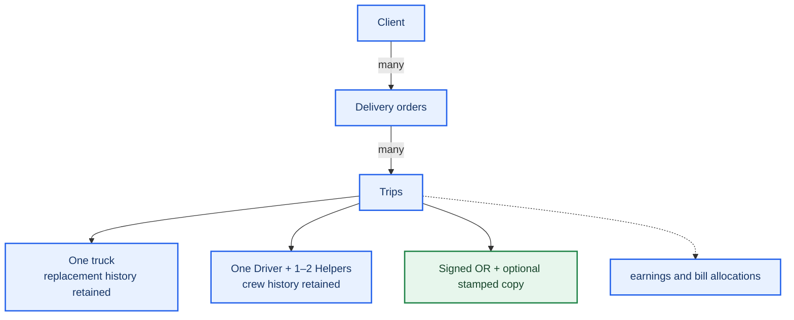
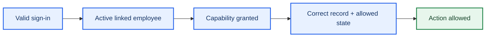
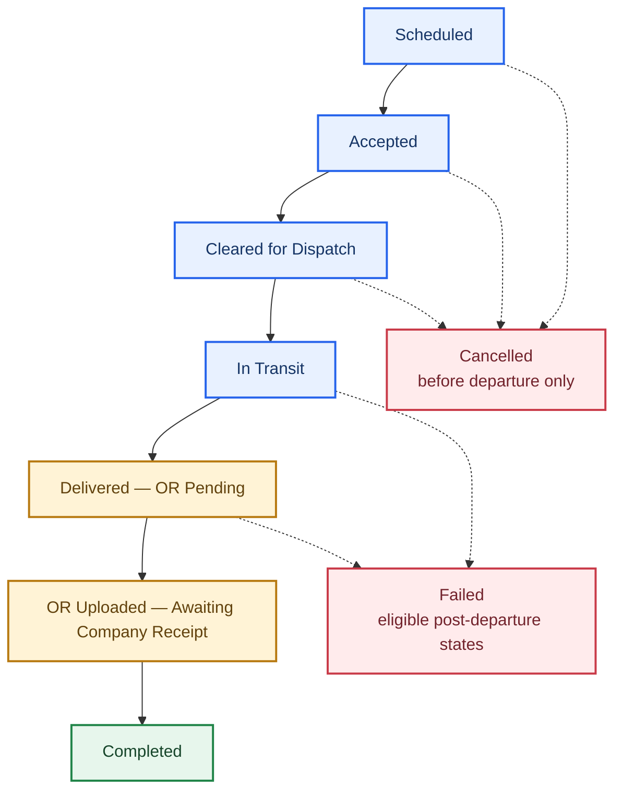
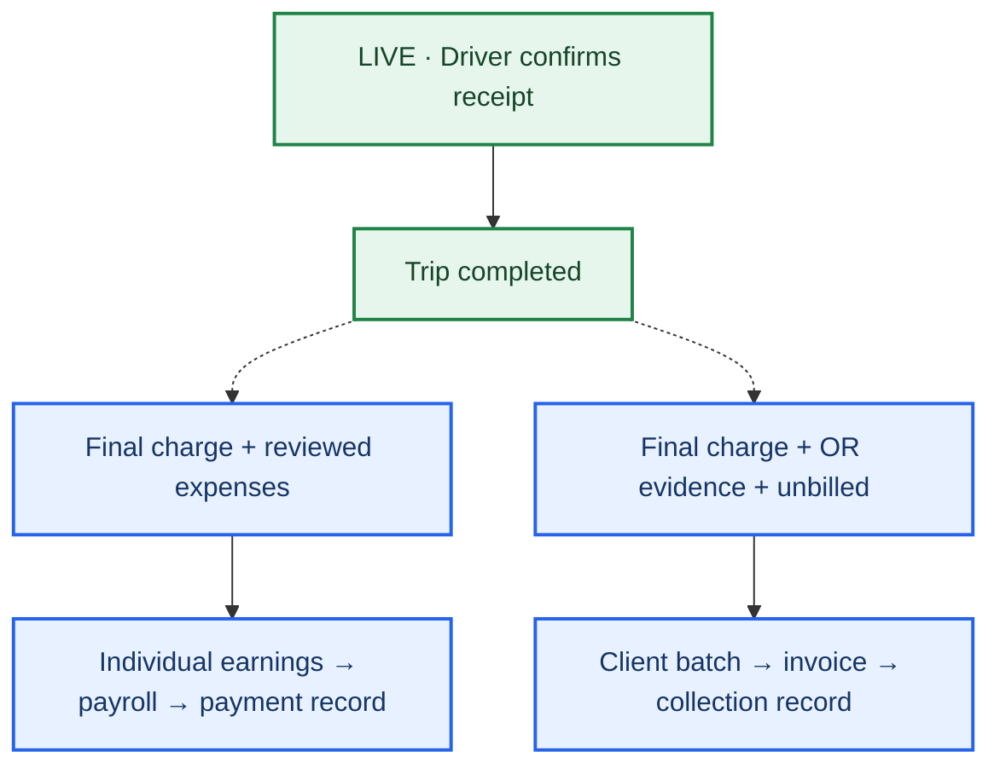

# System taxonomy and terminology

[Documentation index](README.md) · [User procedures](runbooks/user-guide.md)

> **Start with the picture.** Expand the glossary only for an unfamiliar term.

## Business objects

**Clients contain orders, orders contain trips, trips connect vehicles, crew and documents.**

<strong>Glossary and exact names</strong>

| Term                             | Meaning                                                                                   |
| -------------------------------- | ----------------------------------------------------------------------------------------- |
| Client                           | Organization whose instructions BM records; has many orders                               |
| Delivery order                   | Manually entered request with locations, date and total load; may need several trips      |
| Trip                             | One movement belonging to an order, with a truck, one driver and one or two helpers       |
| Crew                             | Assigned driver/helpers; history is retained for accountability and historical earnings   |
| Truck                            | Vehicle with metric-ton capacity, maintenance state and reservations                      |
| Advance assignment / reservation | Next trip allocated after prior signed OR upload; does not authorize departure            |
| Dispatch clearance               | Authorization for an accepted trip to depart after current eligibility checks             |
| OR                               | Delivery document; its formal title remains D1. Do not assume it means “official receipt” |
| Signed OR                        | Receiving party's signed delivery evidence held privately for BM                          |
| Stamped copy                     | Optional evidence of company receipt, distinct from the signed OR                         |
| Company-receipt confirmation     | Assigned driver's statement that the steel company received the OR; completes trip        |
| Employee                         | Local person/role/employment record; may exist without a Clerk account                    |
| User / identity                  | Clerk sign-in linked to an active local employee                                          |
| Capability                       | Backend grant for a particular operation; roles contribute grants                         |
| Audit record                     | Append-only actor/action/record/time/trace history                                        |
| Trip expense                     | Approved operating cost deducted once from the earnings base                              |
| Hauling charge                   | Client charge finalized per trip, separately from completion                              |
| Earnings base                    | Final charge minus approved deductible trip expenses                                      |
| Gross earnings                   | Employee percentage of earnings base before personal deductions                           |
| Net pay                          | Gross earnings minus personal deductions and agreed advance repayments                    |
| Personal advance                 | Personal funds actually released to employee; repayment changes balance                   |
| Operating advance                | Business funds reconciled against expenses/returned money, not automatic employee debt    |
| Billing batch                    | Eligible unbilled charges for one client, possibly from multiple orders/periods           |
| Carry-over                       | Work retained for later billing without changing original delivery dates                  |
| Payment record                   | Actual disbursement/collection record; calculation does not transfer money                |

## Roles and access levels

**Sign-in, active employee, capability and record/state checks must all pass.**

**FULL:** permitted changes · **VIEW:** read only · **LTD:** fewer fields · **OWN:** own records · **No grant:** denied.

<strong>Glossary and exact names</strong>

| Display role   | Stored code     |
| -------------- | --------------- |
| Owner/Manager  | `OWNER`         |
| Dispatcher     | `DISPATCHER`    |
| Fleet Manager  | `FLEET_MANAGER` |
| Driver         | `DRIVER`        |
| Helper         | `HELPER`        |
| HR and Payroll | `HR_PAYROLL`    |
| Accounting     | `ACCOUNTING`    |

| Level    | Meaning                                                 |
| -------- | ------------------------------------------------------- |
| FULL     | Create/view/edit within the capability's business rules |
| VIEW     | Read only                                               |
| LTD      | Restricted fields, e.g. validity without license number |
| OWN      | Own records/assigned crew as the feature permits        |
| No grant | Denied                                                  |

Multiple roles get their strongest applicable grant; ownership/state/separation-of-duty checks still apply. Clerk metadata does not determine application authorization.

## Status taxonomy

**Trip statuses show which action comes next.**

<strong>Glossary and exact names</strong>

| Trip code              | Meaning                                 | Next action                                  |
| ---------------------- | --------------------------------------- | -------------------------------------------- |
| `SCHEDULED`            | Assigned                                | Driver accepts                               |
| `ACCEPTED`             | Driver acknowledged                     | Dispatcher clears                            |
| `CLEARED_FOR_DISPATCH` | Authorized subject to departure recheck | Driver departs                               |
| `IN_TRANSIT`           | Departed                                | Driver records delivery                      |
| `DELIVERED_OR_PENDING` | Delivered, signed OR missing            | Authorized crew uploads                      |
| `OR_UPLOADED`          | Awaiting company receipt                | Driver hands OR over externally and confirms |
| `COMPLETED`            | Receipt confirmed                       | Separate financial processing when ready     |
| `FAILED`               | Cannot complete after departure         | Record reason and review remaining load      |
| `CANCELLED`            | Cancelled before departure              | Review remaining load                        |

Order statuses: `PENDING`, `PARTIALLY_ASSIGNED`, `SCHEDULED`, `IN_PROGRESS`, `COMPLETED`, `CANCELLED`. One completed trip may not complete the whole order. Current defaults free failed/cancelled trip load for reassignment.

Truck statuses: `AVAILABLE`, `ASSIGNED`, `IN_TRANSIT`, `MAINTENANCE`. An assigned truck may receive one advance reservation after OR upload. Use dispatch eligibility and blocking-trip information rather than the badge alone. Maintenance never closes automatically on completion.

## Financial states

**Operational and financial states remain separate.**

<strong>Glossary and exact names</strong>

| Record / view               | Exact code or representation                                                    | Meaning                                                                                                                                              |
| --------------------------- | ------------------------------------------------------------------------------- | ---------------------------------------------------------------------------------------------------------------------------------------------------- |
| Expense sheet               | `ENTERING`, `AWAITING_REVIEW`, `FINALIZED`, `CONFIRMED_ZERO`                    | Editable entry; independent review; approved nonzero or explicit zero. Missing is not zero.                                                          |
| Trip charge                 | `MISSING`, `AWAITING_REVIEW`, `FINALIZED`                                       | A variance waits for independent Owner review. `held` / `hold_reason` are separate fields.                                                           |
| Trip earnings summary       | `PENDING_CALCULATION`, `CALCULATED`, `HELD`                                     | Derived readiness summary; incomplete inputs do not create an earning row.                                                                           |
| Original earning row        | `READY`, `HELD`; nullable `payroll_id`                                          | One original employee/trip entry, with immutable percentage/base/amount snapshots. Payroll allocation is separate from earning state.                |
| Payroll                     | `DRAFT`, `FINALIZED`, `REVERSED`                                                | Draft previews installments; finalization allocates earnings and posts repayments once; reversal is restricted to unpaid payroll.                    |
| Employee adjustment         | `PENDING`, `APPROVED`; nullable `payroll_id`                                    | Independent approval before allocation. Types are `CREDIT`, `DEBIT`, `VOLUNTARY`, `OVERPAYMENT`; personal debits/deductions are disabled by default. |
| Advance workflow            | `REQUESTED`, `APPROVED`, `RELEASED`, `REVIEW_REQUIRED`, `RECONCILED`            | Approval creates no debt. Operating reconciliation can remain under review.                                                                          |
| Personal advance settlement | Displayed `SETTLED` when released principal is positive and its balance is zero | Derived from the movement ledger; repayment reversal restores the balance without deleting history.                                                  |
| Advance movement            | `RELEASE`, `RETURN`, `REPAYMENT`, `REVERSAL`                                    | Separate positive-amount ledger operations; operating returns are not payroll repayments.                                                            |
| Invoice                     | `DRAFT`, `ISSUED`, `VOID_REQUESTED`, `VOID`                                     | Invoice state is separate from collections. `held` blocks issue/collection where applicable.                                                         |
| Bill allocation             | `InvoiceLine.active`                                                            | A trip can have at most one active allocation. An approved unpaid void releases it while retaining line history.                                     |
| Payment position            | Unpaid / partially paid / paid, derived from allocations                        | A fully collected invoice can still have invoice state `ISSUED`; excess collections remain explicit unallocated credit.                              |

UI-only design fixtures may use older illustrative labels such as `ZERO_CONFIRMED`; the persistent expense API uses `CONFIRMED_ZERO`. See [the generated API contract](../src/backend/openapi.snapshot.json) and [working policy coverage](decisions/financial-policies.md#implementation-coverage-and-limits).

Weights are metric tons. Monetary policy uses pesos and decimal centavos. Event timestamps are stored in UTC; business dates/cutoffs use Asia/Manila. Browser date/time controls follow the device timezone; operators should set devices to Philippine time.

